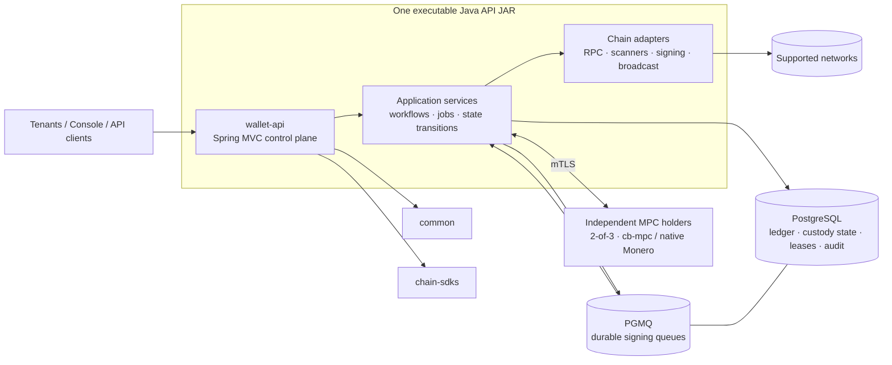

# Surprising Wallet

Surprising Wallet is a multi-tenant blockchain custody platform for exchanges, payment providers, and digital-asset businesses. It provides tenant-isolated deposit addresses, chain monitoring, confirmations, ledger posting, withdrawals, collection, gas accounting, audit trails, and signed webhooks behind one operational control plane.

The project is built for controlled custody operations: PostgreSQL is the source of truth for balances and workflow state, PGMQ transports signing work within the same database, and every enabled chain and asset is controlled through database configuration.

## Supported Chains

The current codebase supports **28 chains across 13 integration groups (13 EVM chains and 15 non-EVM chains)**. The list below follows `common/.../ChainType.java`. Network activation, RPC endpoints, token configuration, and operational switches are database driven.

Icons are loaded from each project's official website favicon. Every icon and network name links to the official project website.

<table>
<thead>
<tr><th>Integration group</th><th>Supported networks</th></tr>
</thead>
<tbody>
<tr>
<td><strong>Bitcoin-like UTXO</strong></td>
<td><a href="https://bitcoin.org/"></a> BTC &nbsp; <a href="https://litecoin.org/"></a> LTC &nbsp; <a href="https://dogecoin.com/"></a> DOGE &nbsp; <a href="https://bitcoincash.org/"></a> BCH</td>
</tr>
<tr>
<td><strong>EVM and EVM L2</strong></td>
<td><a href="https://ethereum.org/"></a> ETH &nbsp; <a href="https://www.bnbchain.org/"></a> BNB &nbsp; <a href="https://polygon.technology/"></a> Polygon &nbsp; <a href="https://arbitrum.io/"></a> Arbitrum &nbsp; <a href="https://www.optimism.io/"></a> Optimism &nbsp; <a href="https://base.org/"></a> Base &nbsp; <br> &nbsp; <a href="https://www.avax.network/"></a> Avalanche C-Chain &nbsp; <a href="https://hyperliquid.xyz/"></a> HyperEVM &nbsp; <a href="https://linea.build/"></a> Linea &nbsp; <a href="https://scroll.io/"></a> Scroll &nbsp; <a href="https://www.unichain.org/"></a> Unichain &nbsp; <a href="https://www.xlayer.tech/"></a> X Layer &nbsp; <br> &nbsp; <a href="https://docs.robinhood.com/"></a> Robinhood Chain</td>
</tr>
<tr>
<td><strong>Hyperliquid</strong></td>
<td><a href="https://hyperliquid.xyz/"></a> HyperCore</td>
</tr>
<tr>
<td><strong>TRON</strong></td>
<td><a href="https://tron.network/"></a> TRON</td>
</tr>
<tr>
<td><strong>XRP Ledger</strong></td>
<td><a href="https://xrpl.org/"></a> XRP</td>
</tr>
<tr>
<td><strong>Solana</strong></td>
<td><a href="https://solana.com/"></a> Solana</td>
</tr>
<tr>
<td><strong>TON</strong></td>
<td><a href="https://ton.org/"></a> TON</td>
</tr>
<tr>
<td><strong>Aptos</strong></td>
<td><a href="https://aptosfoundation.org/"></a> Aptos</td>
</tr>
<tr>
<td><strong>Sui</strong></td>
<td><a href="https://sui.io/"></a> Sui</td>
</tr>
<tr>
<td><strong>Cardano</strong></td>
<td><a href="https://cardano.org/"></a> Cardano</td>
</tr>
<tr>
<td><strong>Polkadot</strong></td>
<td><a href="https://polkadot.com/"></a> Polkadot</td>
</tr>
<tr>
<td><strong>NEAR</strong></td>
<td><a href="https://near.org/"></a> NEAR</td>
</tr>
<tr>
<td><strong>Monero</strong></td>
<td><a href="https://www.getmonero.org/"></a> Monero</td>
</tr>
</tbody>
</table>

## Architecture



| Module | Responsibility |
|---|---|
| `wallet-api` | Spring MVC API and console, scheduled jobs, custody workflows, chain adapters, repositories, gas accounting, webhooks, and startup validation. |
| `common` | Shared chain and asset contracts, MPC transport and signing DTOs, and cross-module infrastructure. |
| `chain-sdks` | Bitcoin-like, TRON, RPC, UTXO, BIP32, Ed25519, and Protobuf based SDK components. |
| `resources/infra/mpc-signer` | Independent native signing service; each holder keeps its own encrypted share. Monero uses its native multisig protocol. |

The Java dependency direction is `wallet-api → common, chain-sdks`. The API calls the independent native holders over mTLS. Inside `wallet-api`, controllers and jobs handle boundaries and scheduling; services own workflows; chain, gateway, coordinator, repository, and configuration packages implement the domain and infrastructure layers. Each SQL repository is responsible for one table.

## Deployment

### Requirements

- JDK 27
- Maven 3.9+
- Spring Boot 4.1.2 / Spring Cloud 2025.1.4（统一由根 `pom.xml` 管理）
- PostgreSQL 17 or newer (local integration tests use the installed PostgreSQL 18)
- PGMQ extension with `send` headers, `read_ct`, `archive`, and `set_vt` APIs (including Supabase's PGMQ 1.5.1)
- Node.js only for the Polkadot runtime bridge and selected test infrastructure

### Local development or a disposable test database

The repository has one canonical database file. It is destructive by design and must be used only with a new or disposable database. The file enables and validates the available PGMQ extension before dropping application tables. Initialize as a database administrator, then provision separate restricted Wallet and approval runtime roles.

```bash
createdb -h 127.0.0.1 -p 5432 surprising_wallet_test_local
psql -h 127.0.0.1 -p 5432 -d surprising_wallet_test_local -v ON_ERROR_STOP=1 -f resources/docs/db/surprising-wallet-init-pgsql.sql
export SW_DB_URL=jdbc:postgresql://127.0.0.1:5432/surprising_wallet_test_local

mvn -pl wallet-api -am clean package
java -jar wallet-api/target/wallet-api-1.0.0-SNAPSHOT.jar
```

Configure API queue access as described in [startup and testing](resources/docs/zh/startup-and-testing.md#pgmq-队列运行与验证). Native holders do not access PostgreSQL or PGMQ.

Disable the development faucet with `SW_WALLET_DEV_FAUCET_ENABLED=false` unless its funding configuration is complete.

Set the database, custody master key, platform administrator, MPC transport, CORS, and chain RPC configuration before starting the services. Do not put private keys, seed phrases, production credentials, or RPC secrets in Git.

Only `wallet-api` produces an executable JAR. It runs the API and chain jobs without wallet Seeds or local wallet private keys. Run three native holders separately with their own storage, encryption key, and mTLS identity.

Configure `SW_MPC_CA_FILE`, `SW_MPC_CLIENT_CERTIFICATE_FILE`, `SW_MPC_CLIENT_PRIVATE_KEY_FILE`, and `SW_MPC_NODE_{1,2,3}_ID` / `_URL`. The transport private key authenticates the API; wallet signing shares stay with the holders. Missing MPC configuration fails startup. See [native service configuration and recovery](resources/infra/mpc-signer/OPERATIONS.md) for holder setup and material preservation. A same-host cold restore has passed; Linux artifact verification has also passed; final all-chain regression remains a release requirement for this branch.

### Linux systemd deployment

The repository includes the API unit under `resources/infra/systemd/`. The native holder has a separate executable and configuration as described in its operations guide.

1. Provision PostgreSQL 17 or newer with a compatible PGMQ extension. On a self-managed PostgreSQL server, install the extension files before running the initialization SQL (this example uses PGMQ 1.11.1):

   ```bash
   git clone --depth 1 --branch v1.11.1 https://github.com/pgmq/pgmq.git /tmp/wallet-pgmq
   make -C /tmp/wallet-pgmq/pgmq-extension
   make -C /tmp/wallet-pgmq/pgmq-extension install
   ```
2. Initialize a new database with `resources/docs/db/surprising-wallet-init-pgsql.sql`.
   On Supabase, use a new dedicated project/database: the baseline deletes existing application tables and the role provisioning script changes schema owners and grants. Validate that the project permits those role changes before storing wallet funds.
3. Install `/etc/surprising-wallet/wallet.env` with API configuration and the authorized MPC transport identity.
4. Configure the three independent native holders, keeping each holder's secrets and storage separate.
5. Install `surprising-wallet.service`, which runs `current/wallet-server.jar`, and validate the API and MPC configuration in an isolated environment before activation.

The service units run as the unprivileged `wallet` user. The API health endpoint is `/actuator/health`.

### Automated backend deployment

The server runs `scripts/deploy/backend-auto-update.sh` every five minutes via `surprising-wallet-auto-update.timer`. It runs `git pull --ff-only origin master` in `/opt/surprising-wallet-source` and compares HEAD with the deployed release. Only a new, undeployed commit triggers a JDK 27/Maven build and unit tests (database/chain integration tests are excluded). The isolated `wallet-build` account owns the checkout and Maven cache; it has no SSH access or wallet secrets. Failed builds leave the running service untouched and retry on the next check. The GitHub workflow validates builds without logging into the host; no GitHub deployment SSH key or repository secret is needed for this public repository.

Install JDK 27, Maven and Git, then run as root:

```bash
useradd --system --create-home --home-dir /var/lib/wallet-build --shell /sbin/nologin wallet-build
install -d -o wallet-build -g wallet-build -m 0755 /opt/surprising-wallet-source
runuser -u wallet-build -- git clone --single-branch --branch master https://github.com/lilaizhencn/surprising-wallet.git /opt/surprising-wallet-source
install -m 0750 /opt/surprising-wallet-source/scripts/deploy/backend-auto-update.sh /usr/local/sbin/surprising-wallet-auto-update
install -m 0644 /opt/surprising-wallet-source/resources/infra/systemd/surprising-wallet-auto-update.{service,timer} /etc/systemd/system/
systemctl daemon-reload
systemctl enable --now surprising-wallet-auto-update.timer
```

`journalctl -u surprising-wallet-auto-update.service` shows pull/build/deployment results. Run `systemctl start surprising-wallet-auto-update.service` to check immediately. The deployment lock prevents overlapping runs; local tracked source changes or a diverged branch stop deployment. The updater limits Maven/compiler/test heaps to fit the small host. PostgreSQL and HTTP bind to loopback; Nginx provides the public entry point.

The activation script checks database prerequisites, stages an immutable release, updates the unit, and verifies health. A failed activation restores the previous JAR and unit when available. Environment files and databases are never replaced by automatic deployment; configuration changes require their own backups. The API unit caps the heap at 640 MiB. To pause automatic updates, run `systemctl stop surprising-wallet-auto-update.timer`. To restore a compatible previous API release, stop the timer, repoint `/opt/surprising-wallet-backend/current` to its saved release directory, and restart `surprising-wallet.service`. Keep the latest database and holder records, and use native binaries that understand the current REFRESH fence and epoch state.

The canonical initialization SQL is applied only once to a new, explicitly provisioned database. Never run it during automatic deployment. Supply `SW_CUSTODY_SECRET_MASTER_KEY` and the MPC transport configuration; development faucet jobs are disabled by default.

### Logs and monitoring

Application logs rotate daily or at 20 MB and are compressed: INFO/WARN archives keep up to 14 days/512 MB, ERROR archives up to 30 days/128 MB. A Python/systemd monitor checks resources, services, HTTPS, PostgreSQL, PGMQ and errors every minute, sending Telegram alerts, recovery notices and a daily summary. Monitoring runs independently of the wallet JVM on the same host and sends directly to Telegram. A full host outage prevents this local monitor from sending alerts. See [operations and monitoring](resources/docs/zh/operations-monitoring.md) for installation, thresholds and rollback.


### 提现与交易端资金闭环

提现创建的永久幂等受理在可变条件前重放；`POST /custody/api/v1/withdrawals/resolve` 只能返回已接受请求或永久拒绝尚未受理的键，不能依赖 HTTP 错误或查询缺失退款。普通 EVM 广播前持久化 nonce、签名字节与业务哈希，故障仅重播同一笔交易；确认失败释放本金并独立结算实际 Gas。完整流程见 [系统代码流程](resources/docs/zh/system-code-flow.md)。

升级存量数据库使用 `resources/docs/db/wallet-withdrawal-closure-upgrade.sql`，必须先停止新提现/签名。旧未知广播不能自动改为失败；缺失受理凭据仍保留原业务单保护，不允许生成错误退款证明。HTTP 金额统一为无损十进制字符串；提现在冻结前验证链精度及 NUMERIC(78,18) 存储范围。

资金池提现：交易所经 Core 可用余额授权后，以租户同链同资产本金池出款，独立保存提现用户。Gas 余额不参与本金；平台费用按原报价内扣，仅确认后入账。托管控制台地址出款须明确提现用户标识。
