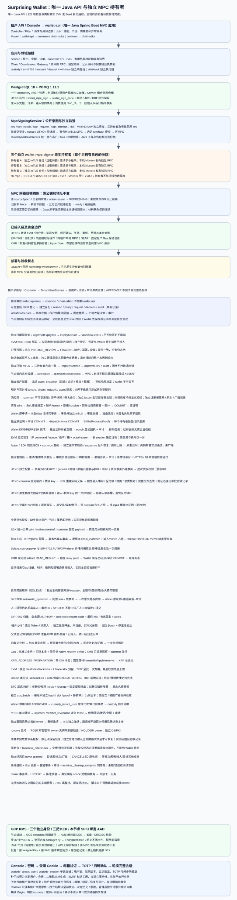

# Surprising Wallet 架构

## 应用与依赖

钱包业务由 Java Spring Boot MVC 应用 `wallet-api` 承载；独立审批服务 `wallet-approval` 使用独立进程、身份和数据库权限。Maven 模块依赖为 `wallet-api → common, chain-sdks`、`wallet-approval → common, chain-sdks`、`common → chain-sdks`。`common` 和 SDK 不反向依赖应用。

三个独立的 `wallet-mpc-signer` C++ 进程通过固定身份的 mTLS 接收钱包签名请求；每个持有者只保存自己的加密份额和持久协议记录，不连接钱包 PostgreSQL。Java 负责业务意图、租户、金额、nonce/UTXO、状态和账务；原生节点负责密码学协议和本机份额。Java 不加载钱包私钥、Seed 或 BIP32 私有根。mTLS 身份私钥与钱包签名密钥用途分开。

| 位置 | 职责 |
|---|---|
| `wallet-api/controller`、`filter`、`exception` | HTTP 校验、身份、响应和异常映射 |
| `wallet-api/job/{deposit,withdraw,custody,collection,devfaucet}` | 调度、节流、防并发与异常隔离 |
| `wallet-api/service` | 业务用例、事务与资金状态编排 |
| `wallet-api/chain`、`coordinator`、`gateway` | 链 RPC、固定交易编码、回执核验和链流程协调 |
| `wallet-api/repository` | 一个 Repository 对应一张业务表 |
| `wallet-api/config`、`bootstrap/ApiComponents` | MVC、数据源、运行时和唯一 API 应用组件 |
| `common/queue` | PGMQ 扩展表适配；不查询钱包业务表 |
| `resources/infra/mpc-signer` | 原生三方协议、mTLS、独立持有者记录和 XMR 桥接 |

Controller 不直接依赖仓储；Job 不执行资金或链流程。Service 使用构造器注入，通过单表 Repository 组合跨表用例，不写 SQL。事务由应用服务编排。

## 持有者存储密钥与 GCP KMS

三个持有者分别使用独立 GCE 服务账号和 KMS CryptoKey；API 与审批服务无权解密持有者 DEK。节点配置仅保存 KMS 完整资源名、绑定本节点证书 SPKI 的 wrappedKey 和系统 CA bundle。`node_storage_key → load_storage_key → Google metadata/KMS` 在监听业务接口前获取并完整性校验原 32 字节 DEK，直接移交不可复制的锁页 `StorageKey`，由 `EncryptedStore` 使用。KEK 不离开 KMS；MPC 份额及不可变会话仍在各自加密目录，签名继续使用现有 MPC，不使用 KMS 代签。KMS 不可用或 IAM/校验错误则启动失败，不随机替换密钥。

正式运行不支持明文 storage key 文件或测试密钥；测试密钥仅在不安装的 fixture 程序中启用。进程关闭 core dump，密钥页禁止交换并在 Linux 排除转储，销毁前清零；宿主机仍须禁用 swap/休眠以覆盖 TLS/JSON 临时副本。恢复依赖原 wrappedKey、KMS 原版本解密能力和原加密记录。一次启动缓存 DEK，故 KMS 撤权不等价于清除运行中的节点。数据库基线无变化。

## 租户与地址

`CustodyAddressService` 接受明确租户和派生主体，在持久化坐标下恢复或创建原 MPC key。`MpcSigningService` 只有取得三份一致公钥的持久完成结果，才能激活并发布地址。XMR 根和子账户由三名独立持有者的官方钱包 RPC 协同建立，Java 只接收公开绑定。

`chain_address` 绑定不可变的 tenant/key/公开地址与主体；客户、Gas、归集和平台中继均有明确归属。地址的公开编码由 `MpcPublicAddressCodec` 和链编码器完成。`ChainAddressRuntime` 只校验公开地址；`BitcoinLikeChainRuntime` 负责公开地址校验、区块观察和已选交易广播。租户地址发布使用统一托管服务。

`MpcNodes` 配置三个不同的持有者身份和 HTTPS 端点，校验 CA、客户端证书及传输私钥。配置概览使用 `mpcConfigured`。应用没有 Java 签名模式切换，`wallet-api` 固定运行 Web/API 和业务调度。

## 签名与恢复

四张表分别由同名单表仓储访问：`wallet_mpc_key`、`wallet_mpc_key_epoch`、`wallet_mpc_sign_request`、`wallet_mpc_sign_attempt`。它们保存租户、公钥、版本、不可变业务载荷、尝试和加密的绑定结果，不保存钱包私钥或份额。

受理 SIGN 时，原 key 锁、余额/nonce/UTXO 和原请求一起提交；远程 MPC 在事务外执行。结果独立验签，原文和本地交易哈希先提交，再查询费用或广播。广播回复丢失仍恢复原请求、原字节和原哈希，不能重建同一资金业务。已知失败、未知、确认与重组有各自状态和审计路径。

原生节点对原会话和记录使用不可覆盖的 AES-GCM 存储。节点证书 SPKI、租户、key、版本、参与方和消息上下文固定；未知签名不被当作没有签名。XMR 使用原两名持有者的原审核及 cosigned/artifact 材料恢复；缺失材料时保留未知和冻结，具体边界见原生服务运行说明。

### 份额刷新

运维以原 sourceEpoch、三名原持有者及不可变 actor/reason 受理 REFRESH。没有未完成 SIGN 才能把 key 置为 REFRESHING。原生接受前先持久化旧版本 fence；新份额另写新版本，旧文件保留。持有者专用 `/v1/refresh-prepared` 核对三份实际持久准备，随后写 ready/完成结果。只有三份绑定原公钥的完成结果齐备，Java 才同事务激活新 epoch、退役旧 epoch 并恢复 ACTIVE。

新份额已持久时可恢复原请求的公开就绪检查，不重新执行随机刷新。缺少私有协议材料时继续冻结。版本为 1–1000000 的整数。`wallet_mpc_key_epoch.refresh_actor/refresh_reason` 与请求不可变；公钥和已发布地址不变。

## 账务、队列与调度

- PostgreSQL 17 及以上版本与支持 headers、read_ct、archive、set_vt 的 PGMQ 扩展是唯一通用中间件；本机集成测试继续使用既有 PostgreSQL 18。`surprising-wallet-init-pgsql.sql` 是空库目标基线；测试只使用既有本机实例内的自有临时库。
- UTXO 签名阶段为 `wallet_mpc_sign → wallet_sign_done`。提现、充值事件、提现事件和 RBF 使用各自既有队列。初次请求、`chain_signing_transaction` 的持久入队凭据、订单与输入锁一起提交；没有额外钱包 Outbox。
- 队列处理在 Service；`read_ct` 栅栏保护领取。处理、下一阶段入队与归档一起提交。原生 MPC 持有者不访问数据库或队列。
- `DepositService` 必须和 `CustodyDepositProjectionService` 在同事务提交充值、余额、租户投影、赤字恢复和事件；地址归属缺失整笔回滚。
- `WithdrawalSettlementService` 同事务校验订单归属/状态/哈希、扣除冻结额和条件确认；竞争失败回滚扣款。
- `CustodyEventService` 和资金事务一起持久化事件及 API 来源 Webhook 投递；Console 来源仍有事件。
- `custodyTaskScheduler`、`evm7702TaskScheduler`、`accountTaskScheduler`、`depositTaskScheduler`、`withdrawTaskScheduler` 分池；Webhook 使用独立执行器。业务 Service 不声明 Scheduled。

## 特殊链流程

| 流程 | 架构约束 |
|---|---|
| UTXO | 固定批次、原输入/金额、租户锁定和每输入 MPC 意图；外部签名组装与独立核验后才提交已选原文 |
| 普通 EVM 与账户链 | 原网络/引用/发送者、nonce、费用上限和固定载荷持久化；恢复使用原元数据 |
| EIP-7702 | 原批次准备、内层 AUTH/OP 与中继 nonce 先受理；中继 MPC 意图及原租户 Gas 先提交，选定 type-4/type-2 原文后广播 |
| NEAR NEP-145 | 同租户 MPC Gas 只签固定原收款人的 storage_deposit；完整 FINAL/receipt/header 区分押金退款与 Gas 退款，注册/Gas 结算后才能原 Token 付款 |
| XMR | Monero 原生 2-of-3；私有钱包及随机材料留在原持有者，本金解锁、原 txset、费用和规范区块独立核对 |
| HyperCore | 固定 owner、网络和动作；真实余额变动与账本核对，不以认证成功替代转账成功 |

## 部署与验证状态

Java 服务单元为 `surprising-wallet.service`，原生三名持有者分别部署。回滚程序版本必须保留最新数据库、份额和原请求/结果，不能用回退资金或随机材料快照替代版本回滚。备份、隔离恢复与未知处理见 [MPC 运行说明](../../infra/mpc-signer/OPERATIONS.md)。

各链实际验收、原始公开证明摘要及命令集中记录在 [MPC 服务说明](../../infra/mpc-signer/README.md)。EIP-7702、NEAR 自动注册、XMR 和 cb-mpc 刷新已有各自实际通过记录；这些记录不能外推为当前整批改动完成。

此前独立 MPC 版本已完成全部 28 条链的最终验收；公开结果见原生服务运行说明。当前分支新增独立审批能力，不能沿用此前验证结果作为本轮审批闭环或上线完成的依据。

## 租户审批改造：子账号基础

租户管理员通过 ConsoleTenantUserController → CustodyTenantUserService 管理 OPERATOR、APPROVER、VIEWER 子账号。用户、会话和审计仍分别使用原单表 Repository；创建/角色或状态变更/密码重置与审计同事务，变更时撤销目标用户的旧会话。禁止 API Key、操作员、审核员管理子账号，禁止跨租户访问或在此入口修改管理员。APPROVER 只有审批相关及读取权限，不能发起提币。此角色仅表示业务权限，不替代独立审批身份和 MPC 交易授权。

## 独立审批服务

`wallet-approval` 独立启动，不扫描 Wallet 业务组件，也不依赖其模块。审批身份与策略位于 `approval` schema，Wallet 数据库角色无权读写，审核员身份不能由 Wallet 子账号重置密码获得。`ApprovalWorkflowService` 编排单表仓储：tenant、member、policy、request、decision、audit；独立会话存于 session，公钥登记使用独立 key 仓储；没有对钱包业务表的 JOIN 或外键依赖。

固定意图包含租户、来源、发起人、链/网络、资产、收款人、金额和网络费上限。独立服务按租户行锁串行处理规则评估，累计窗口包含尚待审核的请求，避免并发拆单绕过；不同链/资产分开累计。每次决策绑定意图哈希和策略版本，两名审核人模式只计算不同审核员；发起人不能自审。决策和审计同事务，审批过期后若已进入签名则不取消。

`common.approval.SigningAuthorization` 定义独立 Ed25519 授权证明，绑定租户、业务意图哈希、链/网络、key/epoch、原会话、参与者及消息哈希，有效期最多五分钟。该格式与持有者强制验证已实测；普通 EVM 与经典 sequence Aptos 的独立校验、Wallet 证明持久化和真实两持有者消费已通过。其余交易族已接入显式校验，未配置独立资产/节点/策略即拒绝签发；逐链策略测试与实际 HTTPS/原生/广播证明分别列于 [审批验收记录](approval-validation.md)，尚未生产部署。

独立服务使用专属 `__Host-sw_approval` 安全 Cookie、严格 Origin/CSRF 检查及独立密码验证。服务间接口从实际 mTLS 证书 SPKI 映射到授权租户，不接受 Wallet Cookie 或调用方声明的角色。原生节点配置独立审批 Ed25519 公钥，SIGN/MONERO_RELAY 必须有有效证明；首次接纳前校验有效期，在加密不可覆盖存储中绑定授权 ID 与原 session，随后才启动密码协议。原会话恢复保留原证明；Java 传输证书本身不再足以提交新的签名。

独立审批过期扫描由 `ApprovalExpiryJob → ApprovalExpiryService → ApprovalWorkflowService.status` 执行，每 5 秒一次，绑定单独 `approvalExpiryScheduler`。每笔请求分别事务处理并保留审计，已开始签名的请求不进入过期取消。金额 API 字段使用十进制字符串，浏览器不以浮点数处理金额。

可信初始登记由独立主机的 `ApprovalEnrollment → ApprovalEnrollmentService → Tenant/Member/AuditRepository` 处理：只读取本机 0600 身份文件，独立密码哈希与登记审计原子提交；该路径无 HTTP 入口，不能由 Wallet 子账号管理调用。

EVM 最终交易校验基础：`EvmWithdrawalVerifier` 直接使用 SDK 解码规范 unsigned wire，重新计算摘要，并匹配独立注册的 key/epoch、链 ID、Token 合约/精度、实际原生币或固定 ERC-20 transfer 收款人和金额，以及审核费上限与独立费上限。它不信任 Wallet 声明的交易语义；EIP-7702 必须走专用批次策略，不能经普通付款路径放行。独立公钥登记、普通 EVM 授权和 Wallet 消费已接入；Aptos 由下述专用校验器处理，其他族通过规范交易与独立事实用例验证；实网部署仍须核验对应节点和资产配置。

公开提币状态投影：核心订单 `PENDING_REVIEW` 保留资金冻结和不可领取签名的内部语义；`PublicWithdrawalStatus` 在创建响应、永久幂等凭据、列表/分页/原请求查询以及事件投影统一显示 `FROZEN` 并隐藏审核等待原因。`custody_withdrawal` 保存公开状态，使状态过滤与分页数量一致；确认投影比较公开状态，不因内部审核等待反复推进或生成审核 Webhook。对外不提前伪造 SENT、交易哈希或确认。独立审批页面仍显示真实审批状态。

新策略默认启用“全部提币需要审批”（ALL_WITHDRAWALS），独立管理员显式关闭后才按单笔/24 小时累计/新收款人/控制台规则放行免审请求。策略 API 必须明确给出 allWithdrawals，缺省值不得悄悄变成免审。独立站退出时撤销旧策略请求并清除旧租户页面状态，迟到响应不能填入另一个租户会话。

独立公钥登记：服务客户端提交原 CREATE_KEY/REFRESH 描述 → ApprovalNativeRegistryClient 使用审批域自己的只读 mTLS 身份直接查询三名固定持有者 → 全部完成且公共身份一致 → ApprovalKeyRegistryService 短事务锁独立租户/公钥 → 首次 epoch 1 或保持同一公钥的连续刷新 → approval.key 与审计原子提交。未配置独立持有者访问时登记拒绝；调用方不能提交结果 JSON 替代实际观察，禁用公钥也不能由 Wallet 重新启用。普通 EVM 与经典 Aptos 的交易授权签发已接入，其他族也使用显式校验；验证范围见 [审批验收记录](approval-validation.md)。

独立公钥登记以 `(tenant_id,key_id)` 为主键，版本与禁用状态也按租户隔离，不通过全局 key UUID 的冲突影响其他租户。

原生授权受理增加首个不可覆盖 admission 证据：在协议启动前先持久化原描述与证明，再写授权 ID / session / request；受理与 ABSENT 查询共用节点锁，首次有效期在锁内按当前时间核验。任一步骤崩溃后已有 admission 的会话返回 INTERRUPTED，不能被误当成从未受理而退款或新建付款；相同原证明可在恢复时补齐持久记录，实际密码协议仍最多启动一次。测试专用故障节点不进入 Runtime 发布包。

独立资产/网络配置由审批主机持有（ApprovalAssetRegistry），Wallet 服务客户端不能编辑。受理时把网络身份、Token 合约/标识、精度和全局费用上限冻结到 approval.request.asset_snapshot，审核哈希同时绑定业务事实与该快照。金额/费用必须符合独立精度，费上限不得超过独立配置；缺少资产配置时拒绝受理。原请求幂等回放保留原快照，当前资产配置变化不得悄悄改写既有审批；审核页面展示原资产/网络标识及费用币种。

审批规则与 24 小时累计窗口按租户、链、网络、资产分别隔离。独立管理员必须为已注册网络显式创建规则；测试网规则不能用于同币种主网申请，主网/测试网金额不混加。

共享不可变协议由 common 承担：MpcSignCommand、WithdrawalIntent、ApprovalAssetSnapshot、SigningCandidate 和 SigningAuthorization；Wallet 与独立审批应用直接依赖同一契约，不反向依赖对方应用。独立授权签名器只在审批域加载 owner-only 0600 Ed25519 PKCS8 DER 私钥，并在启动时用固定域探针验证配置公钥与私钥配对；Wallet 和持有者仅配置该公钥。

最终交易授权由 ApprovalSigningService 编排，五个新增单表仓储分别对应 approval.signing_transaction、signing_version、signing_slot、signing_grant、fee_reservation。mTLS 服务入口接收固定 SigningCandidate，普通 EVM 提币解码实际 wire、核对独立资产快照和已登记公钥；独立租户锁串行执行审批绑定、账户/nonce 占用、原签名槽、原 session 证明、原生手续费累计预算及审计。独立事务提交后才返回证明，已有同 session 只取回原证明。request.signing_transaction_id 同时表示签名已经开始，不再维护独立布尔状态。普通 EVM、经典 sequence Aptos、Bitcoin 类固定批次及其余链各走显式 wire 校验器；替换版本与自动业务也必须通过独立授权。原证明持久化、恢复和实际广播的覆盖边界见 [审批验收记录](approval-validation.md)。

授权的五类收据由数据库触发器禁止更新/删除，已绑定审批不可清空、更换交易或取消状态。所有同网络资产必须使用一致的原生费用币种/精度；累计窗口内发现原费用域与新配置不同则拒绝新授权，不混加不同单位的原子金额。

Wallet 侧新增单表 wallet_withdrawal_approval 与 WalletWithdrawalApprovalRepository，原申请包含租户/订单/网络/金额/费用上限/来源/发起人/外部业务引用/FundingSource，和订单、本金/Gas 冻结及事件同事务提交。WithdrawalApprovalJob 使用 withdrawTaskScheduler 调用 WithdrawalApprovalService，事务外通过 WithdrawalApprovalClient 实际端到端 mTLS（固定审批服务器 SPKI）访问独立服务，短事务应用收据、审计与放行准备。旧全局审批开关删除，所有新提现先保持内部 PENDING_REVIEW，公开模型保持 FROZEN。拒绝/过期只自动释放尚未领取签名且未持久化提交的原订单，本金、Gas 投影和失败事件必须一起提交；已签名/未知交易保持原冻结。普通 EVM 与经典 Aptos 的原生证明消费已实测，其他族通过规范交易与独立事实用例验证；实网部署仍须核验对应节点和资产配置。

原生证明消费由 MpcAuthorizationService 负责：以真实本地原请求/尝试构造 SigningCandidate，事务外向独立服务取最终授权；独立签名及业务哈希、网络、槽、session 全部吻合后，原证明与审计写入 wallet_mpc_sign_attempt.authorization_proof 同事务提交。MpcSigningService 随后提交 RUNNING dispatch fence，再用 submit(Request,Proof) 执行 SIGN。持久化证明不可替换或清空，恢复原件不在 Wallet 重算有效期，持有者仍在首次受理时验期；lifecycle DKG/REFRESH 继续独立原权限。当前消费覆盖所有已支持链的明确付款用途，其他族与 Monero relay 也已接入；实测边界见 [审批验收记录](approval-validation.md)。

可执行产物必须包含同批构建的共享契约：父 POM 的 maven-jar-plugin 强制重新生成薄 JAR，再由 Boot repackage 打包当前依赖，避免增量构建复用旧可执行 JAR 内的 common。HTTPS 验收会校验两个可执行 JAR 内 common 与本轮 common 产物哈希一致；模型搬迁后仍必须 clean 清除旧 class。

公钥登记纳入 Wallet 生命周期：MpcSigningService 本地提交三持有者 DKG/REFRESH 完成态后，MpcAuthorizationService 事务外通过固定 mTLS 请求独立服务观察原 ceremony，再将回执和 MPC.KEY_REGISTER 审计同事务保存到 wallet_mpc_key_epoch.approval_registration。地址发布、新签名准备及后续刷新必须检查已登记 epoch；登记失败保留本地完成事实，按同一原 ceremony 重试，不另建私钥/地址。已有回执直接校验本地原身份，不再访问三持有者，已登记公钥的正常两节点签名可容忍第三台离线。

普通 EVM 恢复使用一个原交易/版本/槽，多个有独立执行描述和操作人审计的 native session。SigningCandidate 携带原尝试的 replayActor/replayReason；approval.signing_grant 按租户/槽/session 唯一保存执行描述、证明和不可改写审计。新 session 必须重新验证原始 EVM wire 与同一账户 nonce，完整命令、版本及审批绑定不可变化；每次证明只绑定本 session，原件不延期。EVM 同账户同 nonce 的签名互斥，故仍只预留一笔费用。未经单独验证的其他链不得借用此恢复规则；Aptos 另见专用 sequence 互斥校验，原生会话恢复不等于再次提现。

Aptos 独立授权边界：公开 BCS 编码与地址工具统一放在 chain-sdks/sdk/signing/aptos，AptosSigningPayload 放在 common.signing，审批服务不得依赖 wallet-api。ApprovalWithdrawalVerifiers 按明确交易族分派 EVM/Aptos 校验器；Aptos 仅接受普通账户 sequence 的 legacy Ed25519 APT / 已登记 primary FA 转账。独立核对 sender 公钥、网络 chain ID、收款人、原子金额、metadata、有效期及 maxGas×price，并重建规范 BCS 与真正送往持有者的全部字节比较；脚本、代付与 orderless 不放行。相同原命令/sequence 的显式新会话恢复保留一个原交易/槽及手续费预留，不允许换 sequence 付款。Wallet maxGas 按配置的总原生费预算除以 gas price 向下取整，不使用会越过审核费限的最小 gas 下限。此编码分层调整不新增表、字段、状态或种子配置，init-sql 无额外变化；Aptos 原生币的独立两人审核、Wallet 证明/审计持久化和两持有者签名已实际通过（第三台离线；未广播）。

独立审核员日常管理：可信主机仅负责最初 TENANT_ADMIN 登记，独立管理员随后通过自身会话/Origin/CSRF 邀请绑定 Wallet 子账号 UUID 的 APPROVER。approval.member 保存 INVITED/RESET_REQUIRED/ACTIVE/DISABLED、激活能力的 SHA-256 与 24h 到期时间（不保存原令牌）；原令牌只返回一次，页面分享链接放 URL fragment。审核员自行设置独立密码后才能登录，激活原子消费且不自动建立会话。重新签发立即使旧链接失效、阻断旧密码并撤销原会话；停用清除激活能力并撤销会话。不可通过浏览器修改自己或其他 TENANT_ADMIN，也没有 Wallet/mTLS 创建或重置审核身份的入口。成员变更和审计同事务，管理员可按租户分页查询原始决策、规则与成员审计。决策使用 member FOR SHARE，与停用/重置排队，防止停用已提交后仍接受旧身份决策；不占用租户 admission 锁。成员、会话、审计仓储仍各访问一表；init-sql 同步成员字段/状态与分页索引。成员管理后端回归及真实 HTTPS 激活/撤销/审计已通过，前端 58 项 DOM 交互测试与构建已通过（未部署）。

UTXO 独立链事实查询（批次授权接入验收中）：ApprovalUtxoRpcProperties 仅从审批主机安装的 chain/network/genesis/只读 RPC 配置绑定；ApprovalUtxoRpcClient 不依赖 wallet-api、不访问钱包表，在任何数据库事务之外调用 getblockhash(0)、getblockchaininfo、gettxout(include_mempool=true)，逐项核对网络、同步状态、原输出金额/锁定脚本与同一 bestblock。金额 JSON 精确保留十进制并转原子单位，缺失/已花费/低确认或观察跨 tip 拒绝。仅 HTTPS 或本机 loopback HTTP，禁止 URL 凭证/query/fragment、禁止重定向，全次观察有总超时与单回复 2MiB 上限；Basic 只读凭证来自 0600 非符号链接文件，不放公共资产快照。此客户端只在首次批准批次的事务外提供链事实；签发必须再完成全部付款/输入/找零校验及永久绑定，单独查询成功不构成授权。本次新增配置/查询组件不改表或初始化种子，init-sql 无额外影响。

UTXO 公开交易校验分层：UtxoSigningPayload 移入 common.signing，所有输入槽共享固定 task/unsigned/keyIds，并显式绑定 changeKeyId；Wallet 保留原批次事务，准备与恢复均检查找零地址由同租户已登记的活动 MPC key 派生。地址派生和输出脚本归 chain-sdks 的 MpcUtxoTransactionCodec，Wallet 与审批端共用公开编码。UtxoWithdrawalVerifier 在独立模块核对批次每笔付款的审核哈希、同一原资产快照、收款脚本和精确金额；逐输入比对只读节点原输出金额/脚本与已登记公钥、租户及当前槽 key/epoch；重建整笔 unsigned wire 并核对真正的 SIGHASH_ALL/ALL|FORKID 摘要。整笔最大费不得超过各批准请求费额合计及独立网络总费限。原生交易金额与精度固定8位，并冻结 utxo:genesis 网络身份。该校验器已接入批次签发，原输出事实、逐输入占用和单次费用同事务编排；真实四-Core 广播与策略测试的覆盖范围见 [审批验收记录](approval-validation.md)。此次公开载荷与编码分层不改 SQL 表/字段/种子；旧类需 clean 清理，DB 基线无额外变化。

UTXO 精度在共享 Asset 构造时即限定8位，校验器先检查族/数量/精度再做金额计算，拒绝 null 与异常精度载荷。Wallet 输入与找零的所有 key ID 合并去重后按固定 UUID 顺序锁定，再按原输入顺序生成签名槽，防止不同批次交换输入/找零角色产生锁顺序环。此边界收紧无 SQL 基线变化。

UTXO 固定批次授权事务：SigningCandidate 审批 ID 统一排序，common.ApprovalTransactionHash 以全部原审批 ID/审核哈希与实际载荷版本生成 V2 businessHash，所有输入槽共用该哈希，原生凭证格式仍为 SigningAuthorization V1。ApprovalSigningService 先短事务检查审批与原槽；未批准/已拒绝/已过期不读取节点。首次批准批次由 ApprovalUtxoRpcClient 在数据库事务外读取，返回后再次锁租户、核对当前原审批/资产/登记输入与找零 key，并拒绝已超过30秒的首次观察。原父业务使用 utxo:task.transactionId，requestUUID 保留为原生版本分组；替换版本仍拒绝。首次授权同事务创建 signing_transaction/version、全部审批绑定、单次 fee_reservation、当前 input slot/grant 与审计；新增单表 approval.spend_lock 逐个永久占用 outpoint，部分重叠输入也不能被另一批次复用，任一步失败一起回滚。approval.signing_version.chain_evidence 保存独立观察原件；后续输入和显式原载荷/原输入恢复只读取该原件，不因链上已花费或原审核期限已过再取新事实。每输入槽只认一个 Wallet request ID，每 native session 只认原证明，不给别名槽重复授权。SpendLockRepository 只操作 spend_lock，其他单表边界不变，收据均由不可改写触发器保护。

Wallet MpcAuthorizationService 对 UTXO 从公共 UtxoSigningPayload 的全部 payment.reference 装载原 Wallet 审批收据；必须全部就绪、哈希与快照一致，独立证明须绑定全部订单与该固定版本。原证明和 MPC.AUTHORIZE 审计提交后才允许 MpcSigningService 调度持有者；一笔就绪不能替代全批就绪。此批次接入新增 spend_lock 表/索引/触发器、signing_version.chain_evidence 及 UTXO 非空约束，init-sql 同批同步；没有向 Wallet 暴露原链事实写入口。当前新增路径待数据库/真实节点验收，其他未实现交易族仍拒绝签发。

### 全链签名授权当前实施状态（未统一验证）

按本次执行顺序，先补齐所有链的授权实现，再统一编译、测试及真实链验收；本段描述新增代码，不声明验证通过或可部署。此前 EVM/Aptos/UTXO 的通过记录仅对应当时的代码版本。

公开交易编码统一下沉到 `chain-sdks/sdk/signing/{solana,ton,tron,xrp,near,polkadot,hypercore,sui,cardano,evm7702}`，纯签名载荷与 ChainScanPoint 分别归 common.signing/common.chain。Sui v2 与 UTxORPC protobuf 源文件及生成入口归 chain-sdks，Wallet 和审批应用消费同一 SDK，不再由 wallet-api 独占生成。共享 SDK 不引用 Wallet Service、Repository 或 Web 类型。

`ApprovalChainRpcProperties → ApprovalChainRpcClient` 从独立主机配置读取网络身份、只读 HTTP/gRPC 地址及 0600 凭证。HTTP 固定允许方法/路径、禁重定向、整次截止时间和 2MiB 响应上限；gRPC 限制回复和整个读取截止时间。Solana、TON、TRON、XRPL、NEAR、HyperCore、DOT、Sui 和 ADA 的节点事实在数据库事务外读取，在首次授权事务内校验新鲜度，写入不可更改的 signing_version.chain_evidence；后续原版本/签名槽读取原件，不让已广播后消失的输入导致另造付款。DOT 的独立 runtime 增加只读 signing-facts 路径，底层 rpcUrl 只能来自审批主机配置。

Solana 全部付款/ATA/业务 memo 重建并比较完整 message，付款人与 Gas 付款人都必须是同租户登记公钥，SPL payer 还须匹配独立安装的 Gas 角色；两个签名槽只占一份交易与费用。Sui 独立读取全部 live 对象的 owner/type/version/digest/balance，不使用历史对象证明可花费性；对象 ID+version 的哈希进入 spend_lock，更新后的找零对象可供新的已审批交易使用。ADA 从真实 UTxORPC 获取原输出 CBOR、创世/网络 magic、协议费率及 tip，验证资产守恒、全输入/找零/收款与 TTL；Token 输出附带 ADA 也计入审核的原生支出预算。DOT 核对实际规范块、runtime 版本、V4 扩展顺序、typed call 索引、精度及费用报价，不接受 Wallet 自述 metadata。

EIP-7702 提现改用共同 `Evm7702SigningPayload.Plan` 绑定全部已审批订单及中继 nonce；授权、operation、relayer 三种槽使用同一个版本哈希。每笔 item 的 ID/金额/收款人/Token 都与原审批匹配；独立 RPC 固定 delegate 地址/字节码 hash/immutable executor、账户与 operation nonce。最终中继 wire 必须携带对应有效内层签名和原 authorization tuple，不得变更 access list、目的地址、金额、nonce 或费率。EVM 原付款账户 nonce 与 EIP-7702 中继/授权 nonce 共享 spend_lock 域，阻止跨流程复用。EIP-7702 归集和其他自动业务仍待补齐独立规则。

XMR PAYMENT 策略和真实原生交易集仍由原两名持有者构造/核验；独立服务额外约束已登记原生子地址、创世/网络、实际收款、金额和最大费用。新增 `WalletMpcRelayRepository` 只访问 `wallet_mpc_relay`：原 relay descriptor 先持久化；独立服务使用 READ_RESULT 身份读取原完成 artifact 的公开绑定，再为原 session/transactionHash/holder 签发 MONERO_RELAY 证明；Wallet 原证明和审计先提交，再调度 native relay。同一持有者使用稳定 relay session，网络重试不得生成新付款或替换证明。新表包含描述/证明不可覆盖与禁止删除触发器，唯一 init-sql 已同步；架构边界测试及统一验证仍待执行。

TON/NEAR/DOT 和 TRON 带宽等协议没有覆盖所有成本的单一 signed max-fee 字段：当前实现读取独立报价/参数，使用保守支出规则，并为整笔交易保留审核额度；该预留不能描述为协议强制的绝对实际费用上限。HyperCore 只允许已激活收款人的 spotSend，实际 wireToken（包括 canonical USDC）必须冻结在独立资产快照中；此直接转账记零网络费但仍保留永久费用收据。所有未知签名/广播继续保留原约束，不清理输入、不解冻或另造交易。RBF、自动归集/Gas/注册/恢复、独立撤销同步及部署权限均有明确实现；源码验证和实际广播边界见 [审批验收记录](approval-validation.md)。

### 独立自动用途规则与原操作凭据（新增代码，未统一验证）

`ApprovalAutomationProperties` 的用途规则由审批主机安装，按 tenant/chain/network/asset/businessType 唯一选择，Wallet/mTLS 和租户浏览器不能增补 treasury/Gas 身份或补充费用额度。集合包含显式 source key 集合、归集/找回固定 destination key、最小/最大金额、24h 金额/数量、永久累计金额/原生费用额度、源账户最小间隔及原生金额/费用比例；FUNDING/DEV_FAUCET 只能使用明确指定的一名来源，RECOVERY 也要求显式来源。归集来源排除已安装的 treasury/Gas/faucet 角色，防止这些角色相互制造扫款循环。

自动业务与人工提现走同一个最终 wire 校验、永久 spend lock、版本/槽/原 native session 证明流程，但没有伪造的人类审批行。`AutomaticOperation` 把 SYSTEM 来源、零人工审核员与 INDEPENDENT_OPERATING_RULE 明确记录在独立用途凭据中；用途规则 fingerprint 绑定进不可变意图哈希。公开人工申请入口继续只接受 API/CONSOLE，不能提交 SYSTEM 绕过审核。Wallet 先验证原证明和用途收据，再把二者及审计同事务写入 wallet_mpc_sign_attempt.authorization_proof/automatic_operation；原证明已保存后，用途收据也禁止改变。

新增单表 `approval.automatic_operation` 与 `ApprovalAutomaticOperationRepository` 保存原交易/规则/来源 key/父业务/本金/原生费用/用途收据。永久费用占用不会因 24h 窗口过去、换规则 UUID 或重复 SIGN 而消失；没有独立终态证据不返还额度。父业务每个准备 scope 只能绑定一次。金额与计数按自动业务类型核算，原生费用按整个同租户链/网络核算，不混加不同精度或资产身份。此表与不可覆盖触发器、Wallet 新字段已同步唯一 init-sql；架构边界测试与统一回归仍待更新/执行。该表使审批域当前增加到十五张业务表。

EIP-7702 自动归集扩展到全部来源的 authorization/operation 与中继槽：固定完整计划、逐来源登记公钥和业务 nonce、delegate 与 collector runtime code hash、delegate immutable EXPECTED_COLLECTOR 以及实际中继许可；最终完整 ABI 重建与逐项有效内层签名、全部原 authorization tuples 和外层 wire 都必须一致。一次批次只保存一份费用和自动用途额度。

NEAR 父业务/支付与 NearRegistrationPayload 下沉 common。`NearRegistrationVerifier` 只允许固定 NEP-145 storage_deposit，独立查询原生创世/引用/FullAccess nonce、Gas 报价、beneficiary 未注册状态、实际 storage minimum 和父 Token 来源余额，校验规范 Borsh；押金与费用一起消耗独立原生支出额度。父付款必须已在独立域获批/准入，不能只凭 Wallet 自述自动补款。通用 Gas 余额缺口、父归集预登记及 XRP activation/TrustSet 已接入下述专用策略；这些权限不由 Wallet 安装或扩展，未配置即拒绝。统一验证正在进行。

### 全链签名授权边界

父归集预登记使用独立 mTLS `POST /approval/service/v1/automatic-plans`：Wallet 仅提交租户、公钥 ID、固定业务引用、资产、收款人与金额，XMR 额外提交原观察描述。独立服务在事务外读取真实来源余额，事务内固定规则、公钥/treasury 角色、收据、原计划及证据，并一次预留金额/次数/最大原生支出。`approval.automatic_operation.transaction_id` 在这一阶段为空，计划和观察必需；数据库触发器只允许一次空值到真实交易的绑定，其余字段永久不可改写。后续最终 wire 授权绑定原计划，不能重复扣额度或更换来源/收款人。ADA、DOT、NEAR、XMR 的 Wallet 准备流程在发起 Gas/注册前先取得该收据。

`ApprovalOperatingBalanceReader` 按链显式查询资产和原生可用余额；不接受 Wallet 余额、节点地址或凭证。通用 Gas 授权同时要求已批准的人工作业或预登记且仍未签名的归集父业务、实际父资产本金、原来源/目标以及真实原生储备缺口。来源须覆盖本金和预留原生支出；Solana 单独核验 Gas payer。ADA/Sui 由真实输入验证覆盖来源余额；7702 归集由自身观察覆盖每个来源和 relayer。XMR 原观察需匹配独立 daemon 的网络/genesis/规范区块，并由只读身份直接取得两名原持有者的已完成结果，允许的高度差最多 10；这不是无条件的实时可用余额保证，最终 native payment 仍须验证真实选币和费用。Monero Digest 计算移到 SDK，仅支持独立安装凭证的一次挑战重试。

XRPL 账户设置使用独立 `ADDRESS_PREPARATION` 用途。SYSTEM 收据本金为零，人工提现与其他自动付款仍要求正本金；激活 Payment 的真实 XRP 转入额连同手续费计入永久原生支出。独立验证固定租户目标公钥和 `prepare:<key>:<symbol>:fund|trust`、发行方/币种、同一 validated ledger 的账户/信任线/准备金、独立安装的 Gas 地址及 trustLimit。激活只能补真实储备缺口；TrustSet 只能设固定限额及 NoRipple，不能改已有启用/有余额/冻结信任线，不能夹带付款、路径、标签、授权或其他字段。Wallet 对相应用途的 Gas 预留与结算保留同一审计链。新增用途及零本金例外已同步唯一 init-sql；不新增业务表。

EVM 所有签名槽追加独立费用事实：配置显式 feeModel、最大签名大小，OP Stack/Scroll 额外配置原生预留及报价余量。独立 RPC 校验 chain ID 和规范块，再读取 L1/operator 费用；7702 在首个内层签名时按整批大小/最大 Gas 预留，最终外层不得越界。总支出包含执行费及额外原生预留，并参与审核上限和一次费用/永久自动曝光。Arbitrum Nitro 不重复加已在 Gas 内的 L1 部分。此预留与报价不构成链上绝对费用上限。参考 [OP GasPriceOracle](https://github.com/ethereum-optimism/optimism/blob/develop/packages/contracts-bedrock/src/L2/GasPriceOracle.sol)、[Scroll 费用规则](https://docs.scroll.io/en/developers/transaction-fees-on-scroll)、[Arbitrum Gas 说明](https://docs.arbitrum.io/arbitrum-essentials/how-to-estimate-gas)。

Bitcoin 类链通过 `ChainType.isBitcoinLike()` 分派；ADA 的 UTXO 模型不再误入 BTC 格式，保留自己的 CBOR、UTxORPC 和金额/输入规则。XMR relay 在原持有者不可读时可尝试另一名原持有者，仅为原 transactionHash 发证明，不新建 PAYMENT；非通信授权拒绝不按成功处理。RBF、无授权终止、撤销传播及部署边界均纳入当前验证入口。策略测试、实际原生协议与实际广播是不同证据；各自覆盖范围见 [审批验收记录](approval-validation.md)，不沿用旧 MPC 验收宣称新审批实网通过。

### BTC 同输入费用替换

独立 BTC RPC profile 可以显式安装 `maximumRbfVersions`（根版本计入，最多 5）、`maximumRbfFeeRate`（最多 1000 sat/vB）和 `maximumRbfFeeAtomic`（最多 100000 sat）；缺失/零值拒绝替换，不会隐式沿用 Wallet 配置。启用时原始签发一次预留全部审核允许且不超过独立资产上限的手续费；后续候选必须严格增费、满足输入金额 10% 限额且不超过原永久预留，不重复计算费用或额度。其他链不借用此规则。

`UtxoReplacementVerifier` 从永久版本重建原审核 ID/哈希绑定，核对原批次 ID、租户、所有 outpoints/金额/脚本/公钥、change key/address、dust 和业务类型；不能增删或重排输入，也不能更换已审核提现收款人或金额。自动归集必须保持唯一原 treasury，净输出只准减去相对根版本增加的确切费用。各版本采用自己的 V2 businessHash，原交易保留根绑定，全部版本与原输入占用、一次费用和审计关联；原输入证据不会因交易已在 mempool 而被重读为“未找到”后放开。它们花费完全相同的输入，在同一规范链上互斥。

Bitcoin 类自动操作收据使用稳定 `utxo:<transactionId>`，各 Wallet 签名请求仍各用自己的 request UUID。归集 RBF 沿用原较大本金曝光，仅扣实际新增费用，不重置金额/次数/永久费用额度。每个版本仍按 input slot 唯一绑定 Wallet ID，原 session 的证明不可改写；新版本另存不可变 receipt 与 `SIGNING.BTC_REPLACEMENT` 审计。该路径源码已编译；真实替换授权/原生签名/节点广播仍需验收。无授权安全终止和撤销传播见下文；已授权短有效期/部分失败/未知交易仍需保留原绑定并对账，不得自动重付或退款。

### Wallet 子账号撤销传播与部署隔离

Wallet 在同一子账号状态/角色、会话撤销和审计事务中，向 `custody_tenant_user` 记录递增的 `approval_revocation_sequence`、待传代次、原操作人及时间；APPROVER 被移除或账号停用触发，重新启用不会清空待传记录。`job/custody/ApprovalMemberRevocationJob` 独立绑定 custodyTaskScheduler，委托 Service 分页读取后在事务外使用真实 mTLS 发送，短事务应用匹配回执并审计。每轮有时间/数量边界，失败保留原代次重试。新证明申请在本租户仍有待传撤销时暂停；缓存原证明继续保留用于原交易恢复。

独立 `ApprovalMemberRevocationRepository` 只访问新增 `approval.member_revocation`，审批域目前共 16 张业务表。最高代次与原描述/hash 永久保存，触发器禁止删除、换租户/成员或回退代次；即使成员尚未登记也保留 fence。新代次在租户短事务内记录 fence、锁定成员、清空 APPROVER 激活能力、停用凭证、撤销会话并审计；成员更新锁与决定的 FOR SHARE 排队。相同代次必须原描述完全一致，旧代次只返回最高回执，不重复停用已经明确恢复的身份。可信主机管理的 TENANT_ADMIN 不能被 Wallet 服务客户端降权。

独立管理员邀请/重置时必须显式确认当前 Wallet 撤销代次。页面列出 walletRevocationSequence；邀请前查询同租户 fence，存在撤销时先要求独立管理员核实本人及当前 Wallet 状态并勾选恢复确认。恢复仍通过独立一次性能力和本人设置密码完成，没有 Wallet/mTLS enable/reset/enroll 路由。传播为跨进程持久重试，不能称为即时跨域原子撤销，也不能声称撤回已签发证明或先前有效审核；停用的是后续身份使用。API/业务用户仍只看到 FROZEN 等正常处理状态。

`common.security.DatabaseRoleIsolation` 只读取 PostgreSQL 17 及以上版本的系统目录，在 Wallet 与独立审批的 ApplicationRunner 中检查真实有效权限；关系访问同时要求所属 schema 的 USAGE，避免把无法实际查询的托管库统计视图误判为跨界访问。Wallet 另校验 PGMQ 队列和租约接口：runtime 非管理/非 DB owner/无其他角色成员资格与 CREATE；Wallet 不得访问 approval，审批不得访问其他应用关系、创建应用对象或外部可调用的 SECURITY DEFINER 函数。检查没有生产旁路开关，失败即启动失败，不在启动时创建/改动角色。Wallet 业务表和独立 approval schema 分别由不同 NOLOGIN owner 所有，runtime 仅获业务 DML；托管库的 public schema 保留平台所有权，Wallet 表的 RLS 策略只允许 Wallet runtime，Supabase API 角色不获业务表权限。

新增 `resources/infra/approval/` 仅提供可审阅部署材料：角色/授权脚本（不建库、不建表或服务）、独立 OS 用户 systemd、无已登记服务证书的公共代理、私网直连 mTLS、只读 native 身份与 issuer 分离、故障/回滚/备份说明。唯一表基线已同步上述用户字段、索引和新单表/触发器，架构边界映射同步新增仓储；没有更改生产角色或部署服务。HTTPS 验收在自己的临时库中配置互异 owner/runtime 与密码；前端、原生授权和受限角色 HTTPS 有各自验证入口，实际覆盖范围见 [审批验收记录](approval-validation.md)。无授权终止见下文；已授权短有效期/部分失败交易继续保持原绑定。

### 未获授权的取消与序号预留（源码实现，未统一验证）

`MpcSignCommand.businessReferences` 将单笔、Bitcoin 类输入和 7702 全批次的业务归属统一为最多 100 个去重引用。在首次 native 请求/尝试事务中同时写入 `wallet_mpc_sign_request.business_references`（数组与 GIN 索引），随后不可改写。清理按真实成员及批次业务引用取齐所有签名槽，不能靠缺失 tx_hash 或某一输入槽判断没有授权。

`WithdrawalApprovalService` 对 EXPIRED/REJECTED 且尚未清理的订单继续轮询，重新通过原 mTLS 读取独立服务状态，核对原意图、资产快照哈希及 `signingStarted=false`。`UnsignedWithdrawalCancellationService` 在原订单事务内锁定相关 native 请求、UTXO 原批次、7702 原批次及相关订单；任何原证明、完成签名、已保存原交易/广播尝试、不同活跃计划的占用或状态矛盾都会保持冻结。一个过期成员不能撤销不包含它的其他原生命令；所有准备命令必须确实绑定该终态意图，才能确认此后独立服务也不会再授权它们。

满足以上条件时，同一事务保存各请求的不可改写 `CANCELLED` 与原独立终态收据、停止未广播批次、释放仅属原 UTXO 批次的输入、将其他仍未出款的批次成员恢复 FROZEN、释放可退批次 Gas，再条件确认 FAILED/退款。本金、Gas 投影、普通失败事件、审计和 `terminal_cleanup_complete` 一起提交；失败全部回滚。CANCELLED 请求不能再绑定尝试、签发/保存证明、分派协议或阻塞 key refresh。终态/清理完成不能回退，原请求和收据永久保留。自动 Gas/注册的已授权子业务不因母提现取消而被伪称未执行或退款。

账户序号与 EVM nonce 现在各用原单表的 `pending_owner` 与 `pending_sequence/pending_nonce` 记录唯一尚未获授权的业务。owner 固定为 tenant/businessType/businessReference；7702 relayer 预留属于整个原批次，不属于某一个 authority 签名槽。分配在单条 SQL 中先取得 owner 范围事务锁，再执行原子 UPSERT，避免首次并发重试在两个唯一索引之间误冲突；同 owner 在受理前幂等返回原值，不同 owner 收到 `NONCE_ADMISSION_PENDING`，7702 工作流保留原 LOCKED 批次重试。第一个真实 issuer 证明与 `MpcNonceAdmissionService` 的准确 wire/key/nonce 受理同事务保存后，才允许后续业务预留；同批后续槽/会话以已保存且验签通过的同版本原证明确认已受理。

这一约束使无授权取消时不会已有后续序号分配。清理只能交回该排他 owner 自己的未受理末端预留，且不低于已观察的链序号；不会回退其他已受理交易。没有使用可任意重排的空洞列表或旧模型兜底。HyperCore 的时间戳通过单独的 timestamp 预留，不按连续账户序号处理。所有新增字段/索引/状态/不可变约束已同步唯一 init-sql；没有新增业务表。

这条路径仅覆盖独立服务确认从未授权的交易。已授权、签名/广播未知、短有效期原命令过期或 7702 部分失败，仍需原交易的安全恢复/链上对账，不能借此退款、换 nonce 或重新支付。取消与并发预留回归覆盖真实 authority 竞争、证明丢回包、投影回滚、批次成员、counter admission、旧任务/旧 session 和多租户边界；范围与证据见 [审批验收记录](approval-validation.md)。

TRON 原 wire 的 `raw_data.data` 只允许空值或 32 字节的业务 memo；实际独立授权必须精确匹配共享 SDK 的 tenant/businessType/businessReference 摘要。不同业务不能通过替换 memo 复用另一原付款，未知 protobuf 字段继续拒绝。TON 的 memo 与 Jetton queryId 由共享 SDK 按 tenant/businessType/businessReference 确定；NEAR Token memo 必须等于原业务 reference。独立端在实际 wire 上逐项校验，不能接受调用方自选附加指令。原生授权用途白名单与 Java 同步包含 XRP `ADDRESS_PREPARATION`，仍须独立签名证明才能受理。
