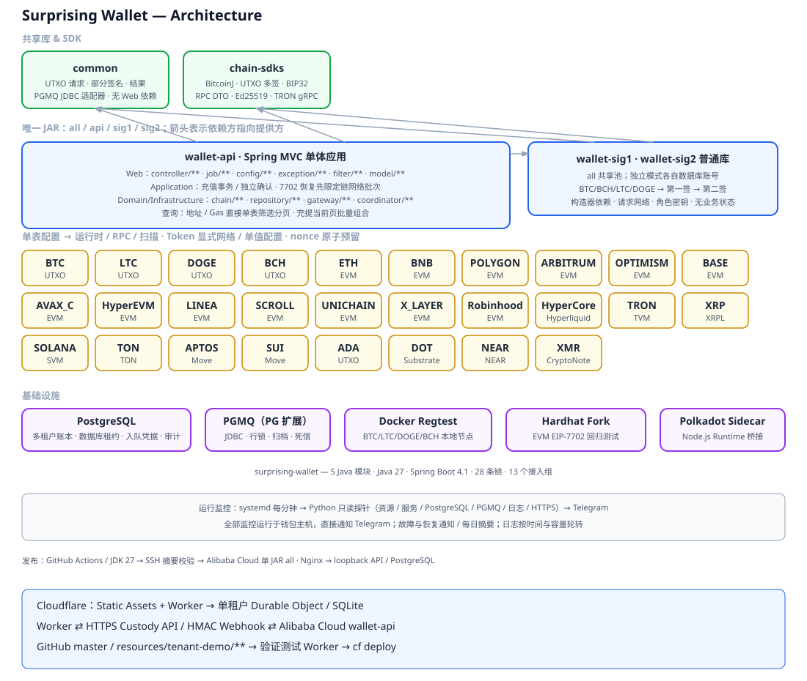

# 架构

全模块位于项目根目录，扁平 Maven 多模块布局。



## Custody 控制面

多租户托管层位于现有链引擎之上：

```text
平台 Console -> 租户生命周期
租户 Console/API -> 租户范围的地址、资产、充值、提现
                         |
                         v
                 现有钱包账本和链引擎
                         |
                         v
                 扫链 / 签名 / RPC 服务
```

租户身份始终来自 Console 会话或 API 凭证。公开地址 API 接收 `chainId` 和租户定义的
`subject` 和可选的 `addressVersion`；同一租户、链、subject 和版本重复调用返回同一地址，递增版本可更换地址，相同 subject 和版本的所有 EVM 链地址一致。扫链确认入账后，会在同一数据库事务中映射 Custody 充值、
租户资产和持久化 Webhook 事件。详见[多租户托管钱包](multi-tenant-custody.md)。

充提历史由 `CustodyTransactionQueryService` 直接编排单表仓储，Console、公开 API 和平台租户详情共用有类型的查询结果。搜索关联地址/交易哈希时先解析同租户主键，再由充提单表仓储执行完整筛选、独立计数与分页，只批量补充当前页的地址和订单。列表与总数使用同一只读快照，不再经过总仓储门面、逐条补查或固定读取 500 条。

## 发布部署

GitHub Actions 使用 JDK 27 / Lombok 1.18.48 构建并执行单元测试，随后通过固定主机公钥、专用受限 SSH 密钥上传带摘要的单 JAR 发布包。阿里云主机只运行 all 模式，不执行 Maven 构建。上传接收器校验摘要和文件名单，以文件锁串行发布；切换失败时恢复旧 JAR 和 systemd unit。部署不执行初始化 SQL，不替换密钥或数据库；旧服务器的发布入口停用。

新主机 PostgreSQL 18 + PGMQ 1.11.1 与应用共机运行，数据库和应用 HTTP 绑定 loopback，公网入口由 Nginx 提供。640 MiB 堆上限配合有限数据库连接池，适用于低负载起步；开链数量仍需按实际负载控制。

运行监控独立于钱包 JVM：systemd 每分钟启动 Python 只读探针，读取主机资源、服务、日志、PostgreSQL/PGMQ 指标及本机/公网健康结果，通过 Telegram 发送故障、恢复和日报。全部监控部署在钱包所在主机，直接向 Telegram 发送通知，不依赖旧服务器；没有额外中间件，也不处理业务队列。整机断电或断网时本机探针无法发送告警。日志有时间与容量限制，详见[日志与运行监控](operations-monitoring.md)。

## 运行模型

`wallet-api` 是唯一可执行 JAR，包含两个普通签名库；默认 `api`。

| `sw.wallet.mode` | 加载组件 | HTTP | 数据源 |
|---|---|---|---|
| `all` | API、链任务、第一签、第二签 | 开启 | 一个共享池 |
| `api` | API、链任务、广播 | 开启 | API 账号 |
| `sig1` | 第一签 | 关闭 | 第一签账号 |
| `sig2` | 第二签 | 关闭 | 第二签账号 |

bootstrap 包按模式显式扫描组件；签名实现由 FirstSignerRegistry / SecondSignerRegistry 通过构造器列表注入，按原生链建立不可变索引并拒绝重复注册。两个模块仅处理 BTC/BCH/LTC/DOGE；EVM/TRON 等账户链继续由 API 内已有链服务签名。第一签和第二签分别绑定单线程 `sig1TaskScheduler`、`sig2TaskScheduler`，API 保持按 Job 类别分池。签名密钥通过限定名称注入，第二签不保留静态私钥或 HTTP 签名入口。所有模式仍通过 PGMQ 推进阶段；合并进程不改变消息重试、幂等和审计路径。


四条 Bitcoin-like 链的签名只依赖必需的密钥与公钥派生组件，无字段注入、ObjectMapper、固定测试网络或测试专用密钥分支。请求中的 Asset 保存数据库链网络，API 地址运行时和签名模块共用 SDK 的 BitcoinLikeNetwork；LTC regtest 使用 rltc 地址。输入金额是唯一合计来源，精确转换最小单位，手续费和汇总检查溢出，产生找零时必须提供目标地址。

运行时资产来源：

| 表 | 作用 |
|---|---|
| `chain_profile` | 链 key、链族、启用网络、确认策略、扫描/提现/归集/划转开关、扫描起始高度、BIP44 coin type |
| `chain_rpc_node` | 每条链的 RPC/fullnode/indexer/faucet 节点、环境标签、优先级、认证和备注 |
| `wallet_system_config` | 全局扫描/提现/归集/划转总开关 |
| `chain_asset` | 原生资产和链内资产定义 |
| `token_config` | token 合约/配置、decimals、归集/提现策略 |
| `ledger_balance` | 按链隔离的用户/系统余额状态 |
| `custody_*` | 租户、凭证、地址分配、充提投影、Webhook、幂等和审计控制面状态 |

应用通过 `chain + symbol` 或 `chain + contract` 解析资产，然后把 runtime asset 传入 scanner、withdraw、collection 和 signing 流程。

`BlockchainRuntimeService` 从启用的 `chain_profile` 解析链元数据，直接调用 `BitcoinLikeChainRuntime`（BTC/BCH/LTC/DOGE）或 `ChainAddressRuntime`（其余链）的地址生成与校验。ADA 的 UTXO 模型由 Cardano 引擎处理，不进入 Bitcoin-like 引擎。账户链扫描、提现和归集由现有业务工作流调用各链实现。项目不再保留通用 BlockchainAdapter、能力注册表或无人调用的转账报价框架；28 条链使用同一套数据库元数据进入租户链列表和开关管理。

运行时配置由 ChainProfileRepository、ChainAssetRepository、TokenConfigRepository 和 ChainRpcNodeRepository 直接映射为有类型的模型；同一张表的运行时查询共用一份映射。Bitcoin-like 使用与其他链相同的 AccountChainProfile 配置，不再重复定义配置类或按网络二次查询。BlockchainRuntimeService 直接依赖配置和资产单表仓储；ChainRpcNodeService 直接依赖 RPC 单表仓储。管理页面需要的字段概览保留为独立查询投影，不再用于重建运行时模型。

`token_config` 的网络为必填非空字段，标准和充提门槛分别只保留 `standard`、`min_deposit`、`min_withdraw`。`TokenConfigRepository` 统一映射为 `TokenConfiguration`；Console、租户资产、Gas/提现和批次流程直接读取类型字段，运行时 Token 定义保留网络身份。运行时查询显式传入已启用链的网络，不做空网络通配或跨网络选择；主键、网络和启用条件直接在单表 SQL 中筛选。初始化基线直接保存完整的 Token 和链资产配置及稳定 ID，不通过旧字段补齐、双写或多次种子更新构造目标状态。

提现创建复用同一运行时地址校验，先验证格式、校验和及 UTXO 网络，再创建订单和冻结余额。Console 根据 Token 配置显示资产明细；链列表契约不再返回闲置报价能力字段。

API 的 `PubKeyConfig` 只通过正常构造器接收角色密钥提供者，不包含测试根公钥、测试构造器或默认测试网络。Bitcoin-like 地址输出为不可变的 `AddressMetadata`；派生使用显式网络和既有非硬化路径 `m/44/coinType/biz/userId/index`，2-of-3 脚本与签名端保持一致。热钱包与充值地址使用 SDK 的同一网络定义，未知网络直接拒绝。

`BitcoinLikeChainRuntime` 读取区块和交易事实，不再回调 `TransactionService` 或持有账务结算依赖。`BitcoinLikeDepositScanService` 按数据库游标取得完整 `UtxoBlock`，交给 `UtxoDepositService` 原子完成 canonical 区块、UTXO、充值、租户投影、PGMQ 通知与游标更新；任一 RPC 交易读取失败时不推进区块。交易哈希和 int 输出序号独立传递，不经过旧 DTO 或字符串解析。`UtxoConfirmationJob` 使用提现调度池，调用 `BitcoinLikeConfirmationService` 观察在途充值与提现；新扫描开关关闭仍继续确认。补确认与重组统一按 canonical 区块、UTXO、充值/账本的顺序加锁。内部提现队列由 `QueuedUtxoWithdrawalService` 直接编排订单与冻结，原混合事务服务和无效果的余额汇总转发均已删除。


充值和重组的事务由 `DepositService` 编排，所有链扫描器直接调用该用例。确认入账时，DepositRecordRepository 的受租户约束状态更新直接返回记录 ID 与入账代次；随后更新账本并调用必需的 CustodyDepositProjectionService，投影、流水、赤字抵扣、事件和 API 来源 Webhook 与余额一起提交或回滚。投影服务要求已有事务，不再使用 Observer 接口、ObjectProvider 或空列表构造路径。SQL 只位于对应单表仓储；地址归属通过同租户派生坐标与地址版本在应用层组合，优先匹配精确地址。

EvmDepositScanner 直接读取链配置、地址、Token 和扫描记录单表仓储，直接调用 DepositService 入账，不再经过通用数据门面。它只有一个构造器；RPC 发现、HTTP 工厂及 WalletRuntimeConfigService 均为必需依赖。测试节点和确认数在测试夹具/测试数据库中配置，生产类不保留固定 RPC、固定确认数或跳过扫描开关的分支。运行开关服务直接依赖 ChainProfileRepository 与 WalletSystemConfigRepository，系统配置按 key 查询并返回有类型的 Setting。

## 模块

| 模块 | 职责 |
|---|---|
| `wallet-api` | Spring MVC 单体应用：Custody/Console REST API、Servlet/Cookie 与 HTTP 异常映射、Job 调度、业务 Service、链领域与持久化模型、链引擎（Bitcoin-like/EVM/TRON/Solana/TON/Aptos/Sui/XRP/Cardano/Polkadot/NEAR/Monero/HyperEVM/HyperCore）、充值、账本、提现、归集、Gas、Webhook 和启动校验 |
| `wallet-sig1` | BTC-like 2-of-3 第一签服务：对 BTC、BCH、LTC、DOGE 提现交易生成部分签名，轮询 PostgreSQL / PGMQ 队列；处理中任务可恢复 |
| `wallet-sig2` | 第二签服务：完成最终签名并入 PGMQ 广播队列，由 wallet-api 广播；处理中任务可恢复 |
| `common` | 无 Web 耦合、至少被两个上层模块使用的共享契约和 PGMQ 基础设施：运行时链/资产契约、不可变 UTXO 签名请求/部分签名/结果契约、钱包密钥配置与加载、通用常量 |
| `chain-sdks` | 与业务和数据库无关的链 SDK：BitcoinJ 网络参数、Bitcoin-like RPC DTO、多签地址、SegWit 交易、UTXO 选择、BIP32、SLIP-0010 Ed25519 派生与签名、TRON gRPC/Protobuf/ECKey |

所有模块的 parent POM 为根目录 `pom.xml`，继承 Spring Boot starter parent，以 Java 27 作为统一编译和运行基线，并提供统一的版本和依赖管理。

模块依赖遵循 `wallet-api -> wallet-sig1, wallet-sig2, common, chain-sdks`，签名服务分别直接依赖共享库和链 SDK。`wallet-api`
内部采用 MVC 分层：Servlet 请求、Cookie 读写和 HTTP 状态映射只存在于 Web 层的 Controller、Filter
和异常处理器；Controller 只做参数校验和响应映射，Job 只负责调度、节流、防并发和异常隔离，选币、状态流转、队列消费、RPC 调用和审计由业务 Service 承担。
Web 层包固定为 `controller/`、`job/`、`config/`、`exception/`、`filter/` 和 `model/`；认证过滤器及其
Servlet 请求包装器不得放入 `config/`，充值扫描使用的检查点模型归入 `chain/model/`。链上网关统一位于
`com.surprising.wallet.gateway`，链操作协调器统一位于 `com.surprising.wallet.coordinator`，二者不得放回
`service/` 包；协调器使用 `@Component`，业务工作流才使用 `@Service`。
所有应用 Service（包括工作流和实现类）统一位于 `com.surprising.wallet.service`，使用 `service/**` 单层包，
不再按业务域拆分 `account/service`、`custody/service` 或 `devfaucet/service`，也不保留 `impl` 子包。
所有业务域的 PostgreSQL/JDBC Repository 统一位于 `com.surprising.wallet.repository`，业务包下不再保留
`account/repository`、`custody/repository`、`deposit/repository` 或其他分散的 Repository 子包。
Service 和 Job 统一使用构造器注入；可选基础设施依赖以 `Optional<T>` 表达。
`CustodyAddressService` 直接编排地址、主题派生、链地址、Gas 账户、账本和审计单表仓储。地址分配在原事务内解析一次主题并持有锁；同租户主题/版本幂等、链地址归属、EVM 委托投影和审计共同提交或回滚。EIP-7702 仓储为正常构造器依赖，不再通过测试构造器或 Optional 跳过投影。托管地址行由 `CustodyAddressRepository` 唯一映射为 `CustodyAddressRecord`，不经总仓储二次重建。
地址列表、总数与搜索使用同一单表筛选条件，排除本租户所有 Gas 地址后再分页。平台租户详情复用地址服务的内部查询。可提现地址按租户/链/主题读取，再批量组合链地址和账本余额；不逐页扫描全租户或逐条查询余额。Gas 历史直接按租户和账户/地址筛选分页；账户身份查询不再加载账本余额。Gas 使用明细直接返回有类型的公开查询字段，不在总仓储中复制和重命名 Map。
APTOS、ADA、NEAR、DOT、SOLANA、SUI、TON、XRP 的扫描器和交易服务必须通过构造器接收运行时开关服务，不再通过字段注入或空依赖跳过校验。Solana 扫描器的 ATA 地址服务和 TON 扫描器的索引器同样是必需依赖；TON 网络始终读取数据库 profile，不保留默认测试网络或测试专用构造器。单元测试提供明确替身，数据库链路测试使用实际开关服务。
`CustodyEventService` 显式编排领域事件、启用端点和 Webhook 投递记录，加入调用方事务；独立调用时也原子提交或回滚。充值投影直接依赖该服务和审计单表仓储，不再经过 `CustodyRepository`。提现创建、状态同步和资产找回共用同一事件入口，保持 API 来源才生成 Webhook 的规则。事件按业务键去重，投递按端点与事件的已有唯一键去重，重复调用不重置投递状态。托管控制面的事件发布使用必需构造器依赖，不提供测试专用或兼容构造分支。
`common.queue` 提供无 Web 依赖的 PGMQ JDBC 适配器和消费事务执行器，唯一启动入口显式导入配置。
业务 Service 通过适配器使用队列，不直接编写 SQL；`ChainFeeRateRepository` 只访问 `chain_fee_rate`。
EVM 普通交易和两个 EIP-7702 协调器直接注入 `EvmNonceRepository`。Nonce 预留通过一条 `INSERT ... ON CONFLICT ... RETURNING` 完成，独立调用也可并发分配，加入已有事务时可随签名/Gas 失败回滚；不再经通用门面传递，也不做 BigInteger/long 往返转换。输入沿用 uint256 校验且不返回范围外值；生产代码不保留覆盖已预留计数的通用 upsert 或测试 DTO。
RPC 客户端直接注入 `ChainProfileRepository` 与 `ChainRpcNodeService`，不再经过 `ChainJdbcRepository` 转发链配置。节点选择、故障切换、认证和 provider 限流只有一条路径；本地测试通过配置仓储提供节点，生产代码不保留固定测试端点或空依赖构造分支。`ChainRpcNodeService` 的环境名和并发上限由唯一构造器注入。

`WithdrawalSettlementService` 统一编排单笔提现确认：租户、订单状态和交易哈希校验、冻结余额扣款、订单条件确认在同一事务中完成。各链交易服务、UTXO 结算、账户链工作流和 EVM 批量提现协调器直接调用该用例，结算入口必须明确租户。原有余额更新和状态条件更新顺序保持不变，竞争失败时全部回滚。

各模块分别声明自身实际使用的 starter，避免依赖传递造成的隐式可用。

链配置、链地址、交易、账本、订单和扫描记录由调用方直接注入各自的单表仓储，不经过统一链数据门面。跨表规则由明确用例处理：`CollectionPlanningService` 计算充值减已归集金额、抑制在途重复归集并解析租户归集地址；`UtxoSelectionService` 在调用方事务内完成租户输入选择和锁定；`WithdrawalClaimService` 以重组赤字检查和条件更新领取租户提现；`EvmBatchOwnershipService` 检查批次接管状态，批次身份始终使用 UUID。`AccountSequenceRepository.reserve` 用单条 UPSERT RETURNING 预留序号，独立调用也不会重复分配，加入业务事务时随外层回滚。测试使用实际仓储/用例的正常构造器，不继承生产数据门面或在生产代码中保留测试装配入口。

Repository 采用“单表一仓储”约束：每个 `@Repository` 只访问一个数据库表，Repository 名称与表职责一一对应。
Console 认证由 `CustodyAuthService` 直接调用用户、租户、会话和审计单表仓储，登录事务由该服务持有。
用户、租户和有效会话事实在认证服务内组合，生成包含当前状态的认证记录，不再引入独立查询中间层。
登录、会话访问和平台管理员初始化不再经过 `CustodyRepository`、`CustodySecurityRepository`。
托管业务记录位于 `model/custody`，调用方不依赖总仓储的嵌套类型。安全组合组件只保留正常注入构造器。
`CustodyRepository` 等托管控制面组合组件使用 `@Component`，自身不执行 SQL，只在 Java 中组合
单表仓储并维护必要的事务边界；它们不属于 SQL Repository。Service 不持有 `JdbcTemplate`、不执行 SQL，负责业务规则
和工作流调用。任何 SQL Repository 内禁止使用 JOIN、跨表子查询或同时读写多张业务表。

`com.surprising.wallet.chain.model`、业务数据库记录和转账请求模型属于 `wallet-api` 内部领域层。
Bitcoin-like RPC DTO 与 Ed25519 链枚举、派生结果和 SLIP-0010 密钥提供者位于 `chain-sdks`；`common`
不直接声明 BitcoinJ 或 EdDSA，也不再通过全局 `Constants.NET_PARAMS` 暴露链 SDK 类型。数据库/JDBC
模型不得进入 `chain-sdks`。

签名协议为 `UtxoSigningTask(request) → UtxoPartialSigningTask(partial) → UtxoSigningResult`。输入自身包含 outpoint、金额、地址及派生坐标，不传平行 UTXO/地址数组。签名实现返回值或抛出异常，不修改业务实体或 JSON；只有队列与数据库边界使用 Jackson。第二签从原始交易计算真实费用并核对输入身份。

`chain_signing_transaction` 分别保存有类型的 request、signed_transaction 和完整 attempts 快照；链、租户、请求 UUID、业务类型及当前哈希由 JSON 生成数据库列，唯一键、索引及租户外键直接使用生成列，避免手工同步两份身份。API 内的 UtxoSigningTransaction 管理生命周期，签名服务不接收数据库状态或历史。UtxoBroadcastService 在同一签名行锁下校验结果身份，持久化签名事实后广播；初次广播 UNKNOWN 也保留哈希并继续确认。SIGN_DONE 队列的持久化结果在失败重试期间保留原始签名，禁止释放任何已有已签尝试的输入。

批处理、请求提交、RBF、广播、确认和内部归集识别直接调用 ChainSigningTransactionRepository，总仓储不再转发签名表方法。RBF 保存完整请求与签名快照，原尝试确认时恢复对应金额与实际费用；提现先将已验证的历史尝试标为 CONFIRMING，再由 WithdrawalSettlementService 扣款确认。签名行、订单、UTXO 与余额更新在同一事务中提交或回滚，终态不可重开。

## 调度与运行时开关

- wallet-api 的每个 `@Scheduled` 入口都通过 `wallet_task_lease` 获取数据库租约；租约按任务名唯一，执行期间由心跳续租，实例故障后由其他实例接管。租约只负责调度所有权，业务数据仍由各自的事务和单表 Repository 维护。
- 独立 sig1/sig2 模式使用独立账号连接同一个 PostgreSQL，仅访问授权的 PGMQ 队列。消费按消息领取，处理事务持有该消息行锁；read_ct 校验阻止旧消费者确认新领取的消息。
- UTXO 批处理通过 `UtxoSigningSubmissionService` 锁定持久化签名请求，校验租户和请求版本，再将 PGMQ 入队及 `chain_signing_transaction.enqueued_signing_request_id` 去重凭据与订单、UTXO 状态一起提交。无需 Outbox 表或派发任务；消息归档后凭据仍阻止同一请求重复投递。消费事务原子完成业务状态更新、下一阶段入队和当前消息归档。异常回滚，指数退避重试；第 20 次失败进入死信队列。
- 提现领取按 `tenant_id` 轮转，Webhook 领取按租户公平排序；任何租户的慢 RPC、慢回调或积压都不能长期饿死其他租户。幂等键、状态机、锁定余额、失败释放和链上对账共同构成资金闭环。
- EIP-7702 归集与提现恢复先按链、网络和 `BROADCAST_UNKNOWN` 状态读取批次主键，再在尝试单表中限定这些主键、检查冷却时间并排序分页。批次全局主键及租户/批次复合外键保证返回尝试保留原租户归属；无目标批次时不读取全局 UNKNOWN 窗口。
- Account-Chain 调度器每秒做轻量到期检查，UTXO 调度器每 5 秒检查；只有达到该链扫描周期时才访问 RPC。
- 扫描周期由 `WalletRuntimeConfigService` 集中维护，快速链为 2-5 秒，ETH 为 12 秒，ADA 为 20 秒，DOGE/LTC/BTC/BCH 为 15/30/60/60 秒，未知新链默认 10 秒。
- 每次实际执行都实时读取 PostgreSQL 中的 `global.all.enabled`、全局任务开关和 `chain_profile` 链级任务开关，后台修改无需重启。
- 开关关闭时阻止新的扫描、提现构建、归集和转账动作；已广播交易的确认、对账与回调继续运行，避免资金状态永久停留在中间态。
- 已观察充值通过独立确认用例继续入账；必需的托管投影不再次检查新扫描开关或租户链开通状态。找不到同租户托管地址时抛错，充值记录、余额、投影和事件全部回滚。
- XMR 使用独立串行全流程任务，不再由通用 Account-Chain 扫描任务重复执行。

## 链族

当前支持 28 条链，其中 EVM 链 13 条、非 EVM 链 15 条；架构图和下表列出全部支持链。

| 链族 | 链 | 本地测试支持 | live/testnet 支持 |
|---|---|---|---|
| Bitcoin-like UTXO | BTC, LTC, DOGE, BCH | Docker regtest 节点 | 外部 RPC 配置 |
| EVM | ETH, BNB, POLYGON | Hardhat fork | Sepolia、BSC testnet、Amoy |
| EVM L2 / L3 | ARBITRUM, OPTIMISM, BASE, AVAX_C, X_LAYER, ROBINHOOD_CHAIN | Hardhat fork | Sepolia L2、Avalanche Fuji、X Layer Testnet、Robinhood Chain Testnet |
| EVM L2 (新增) | LINEA, SCROLL, UNICHAIN, HyperEVM | Hardhat fork | Linea Sepolia、Scroll Sepolia、Unichain Sepolia、HyperEVM testnet |
| TRON | TRON | DB 测试 | Nile live flow |
| Solana | SOL | DB 测试 | Devnet live flow |
| TON | TON | DB 测试 | Testnet |
| Aptos | APT | DB 测试 | Testnet |
| Sui | SUI | DB 测试 | Testnet |
| XRP | XRP | DB 测试 | Testnet |
| Cardano | ADA | DB 测试 | Preprod testnet |
| Polkadot | DOT | 本地 dev 链 + Node.js Sidecar | Westend + Asset Hub |
| NEAR | NEAR | DB 测试 | Testnet |
| Monero | XMR | Docker regtest wallet-rpc | Testnet |
| HyperCore | HYPE | DB/API 测试 | Hyperliquid testnet API |

HyperEVM 复用 EVM 通用路径。HyperCore 使用独立的账户层适配器，通过 Hyperliquid `/info` 和 `/exchange` API 工作。Polkadot 通过 `resources/infra/polkadot-runtime-service` Node.js 桥接服务与链交互。参见 [HyperEVM 与 HyperCore 接入说明](hyperevm-hypercore.md)。

## 签名模型

密钥通过环境变量注入唯一 application.yaml，按模式加载本方 Seed 与必要的扩展公钥。恢复私钥离线保存，运行时只配置 recovery-public-root。api 保留账户链使用的 sig2 和 Ed25519 私钥；sig1 / sig2 各自只要求本方 Seed。all 同一进程持有两方私钥，不提供进程级密钥隔离。Bitcoin-like 链使用其中三组 BIP32 root：

```text
BIP32 root #1 -> pubKey1，在线第一签私钥 root
BIP32 root #2 -> pubKey2，在线第二签私钥 root
BIP32 root #3 -> pubKey3，离线恢复私钥 root
```

SOL/TON/APTOS/SUI 使用第四个 Ed25519 master seed：

```text
Ed25519 Seed -> SLIP-0010 Ed25519 派生 -> 每条链/每个用户 key
```

生产环境不要把 BIP32 raw seed 复用为 Ed25519 seed。不同生产根密钥材料应隔离。

## 主流程边界

Scanner：

- 读取链状态。
- 匹配 `chain_address` 中注册的地址。
- 向 `deposit_record` 写入归一化充值事件。
- 幂等入账 `ledger_balance`。

Withdraw：

- 从数据库解析资产配置。
- 锁定 ledger balance。
- 构建、签名、广播交易。
- 确认并释放/完成 ledger 状态。

Collection：

- 扫描可归集用户余额。
- 从 `token_config` 读取资产策略。
- 构建到固定默认热提钱包的转账；默认热提钱包为每条链原生资产 `chain_address` 的 `user_id=0/biz=0/address_index=0/wallet_role=DEPOSIT`。
- 确认并幂等更新 ledger 状态。

## 启动配置校验

wallet-api 启动时会先校验当前模式所需的 `sw.wallet.keys`，再检查 `chain_profile`、`chain_rpc_node`、默认热提钱包和 `wallet_system_config`。密钥配置缺失或非法会直接启动失败；校验通过后，默认热提钱包会通过代码推导并与 `chain_address` 比对，缺失或不一致同样会启动失败。同一链同一时刻只能启用一个网络；非生产环境可以同时保存 devnet/testnet profile 并切换启用，生产环境只允许启用生产网络。启用 profile 必须至少有一个匹配当前环境的 RPC 节点。校验结果会按链打印状态，缺失配置或关闭开关会输出 WARN。

## 运行目录

`resources/` 下集中存放 infra（EVM fork、Polkadot sidecar、regtest、Move 合约、systemd 服务）、docs（文档、SQL）和 scripts（测试启动脚本）。

### PostgreSQL 队列与费用报价

PGMQ 扩展管理 `pgmq.q_wallet_*`、对应归档表和死信队列。`common.queue.PgmqClient` 只访问扩展对象，不访问业务表。
`ChainFeeRateRepository` 对应 `chain_fee_rate`（链、整数费率、更新时间），由费率更新、提现和 RBF 服务直接访问，提供网络报价。
队列消费由 `WithdrawalQueueService`、`FirstSigningService`、`SecondSigningService` 和 `RbfBumpService` 编排；Job 仅调度。
已移除独立失败重试和超时重投签名 Job，PGMQ 未确认消息在可见性超时后恢复。
队列归档用于审计；运维使用 `wallet_replay_dead(queue, id, reason)` 重放死信，并记录数据库操作者和原因。
PGMQ 的消息行锁与 read_ct 校验保证领取和确认安全，链上 RPC 仍须依赖交易 ID 幂等及未知结果对账。

## Cloudflare 租户 Demo

`resources/tenant-demo` 是独立租户应用，部署为 Cloudflare Worker + Static Assets + SQLite-backed Durable Object。每个部署固定对应一个钱包租户，浏览器不能选择租户对象。用户、会话、余额和流水保存在该对象内；仅通过 HTTPS Custody API / HMAC Webhook 与阿里云钱包协作，不访问钱包数据库。API 密钥、Webhook 密钥及管理令牌使用 Worker Secrets。master 分支的 Demo 目录变更触发 GitHub Actions，先验证独立测试 Worker，再部署正式 Worker；不会触发钱包后端发布。

LTC regtest 地址与网络标识依据 [Litecoin Core v0.21.4 CRegTestParams](https://github.com/litecoin-project/litecoin/blob/v0.21.4/src/chainparams.cpp#L251)。SDK 只用于钱包地址与交易，不执行 Litecoin SPV 验证。


EIP-7702 归集与提现工作流共用 `Evm7702RpcClient`，由其选择当前链网络的 RPC 节点、构造 Gas 估算信封并读取合约、代码哈希和回执。普通 EVM 与两个批量工作流共用 `EvmTransactionReceipt` 的标准字段、L1 费用及 operator 费用字段；密钥转为 EVM 凭证由现有 `AccountSecp256k1KeyService` 负责。工作流直接调用链客户端和资产服务，取消同名私有转发方法，批次领取、广播恢复和账务事务边界沿用各自用例。
