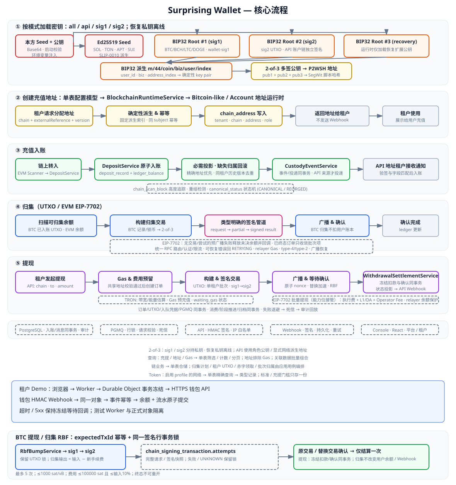

# 运行代码流程




## 密钥加载与角色隔离

```text
按角色独立的环境变量 -> JAR 内唯一 application.yaml
  -> Spring sw.wallet.keys
  -> RuntimeKeyConfiguration -> WalletKeyMaterialProvider
  -> 按 all/api/sig1/sig2 模式校验所需的 Base64 32 字节 Seed 与扩展公钥
  -> wallet-api：sig2 私钥 + 三组 public root + Ed25519
  -> wallet-sig1：仅 sig1 私钥 + 三组 public root
  -> wallet-sig2：仅 sig2 私钥与自身 public root
```

唯一 JAR 的 all 模式在一个进程内运行全部阶段，共享数据源但隔离签名调度池；分进程模式使用同一个 JAR。第二签没有 HTTP 入口，签名消息始终经过 PGMQ。FirstSignerRegistry / SecondSignerRegistry 由构造器接收原生 UTXO 签名实现，不再访问 Spring ApplicationContext；账户链不进入此队列。恢复私钥不加载，只输入扩展公钥。api 模式仍承担账户链签名，需要 sig2 和 Ed25519 私钥。

密钥不再写入 PostgreSQL，也没有运行时查询、明文展示或热更新接口。配置变更必须重启对应进程；已有派生地址后更换 Seed 会导致签名材料与地址不一致，因此必须作为受审计的整体密钥迁移处理。

## 多租户托管流程

托管控制面不管理交易所内部的用户模型。租户传 `chainId`、自己的 `subject` 和可选的 `addressVersion`，服务根据该链唯一启用的网络返回稳定地址。

```text
交易所后端
  -> 通过 HMAC 鉴权调用 POST /custody/api/v1/addresses
  -> 按 tenant + chain + subject + addressVersion 查询或创建 custody_address
  -> addressVersion 默认 0；递增版本即可更换地址，旧地址继续监听
  -> 相同 subject + addressVersion 的所有 EVM 链返回同一个地址
  -> 返回地址 ID、链、自动选择的网络、subject、addressVersion 和地址

链上扫描器
  -> 在同一事务中写 deposit_record 并增加 ledger_balance
  -> 充值地址按交易目标地址优先匹配；同一租户的历史地址版本按 tenant 去重
  -> 写 custody_deposit 投影
  -> 写持久化 custody_event
  -> 仅当充值地址由公开 API 创建时，为每个端点生成 webhook_delivery
  -> 签名回调 DEPOSIT.CONFIRMED，并带回 subject 和充值地址；Console 地址不自动投递
  -> 签名绑定 eventId、eventType 和原始 Body，接收方验签后再校验 Body 身份字段
```

新扫描开关、租户链开通状态只控制新业务入口；已观察的充值必须继续完成投影、流水与事件。托管地址归属缺失时整笔充值回滚，不允许只增加账本余额。禁用或历史版本的托管地址仍按实际收款归属记账。

Console 可附带标签和元数据手动创建地址；公开 API 不接收这些管理字段。地址仍计入租户资产总额，但其后续充值不自动投递 Webhook。创建地址本身也不产生 Webhook。所有 Console/API 查询和变更都强制应用租户隔离。

Console 登录：Controller → `CustodyAuthService` 直接读取单表仓储，组合用户及当前租户状态 → 密码/锁定校验 → 用户登录状态、会话哈希和审计在一个事务中提交。密码错误抛出未授权异常时保留失败计数，达到五次锁定十五分钟；会话或审计写入异常则回滚本次登录成功状态和会话。平台管理员与租户用户使用各自登录入口。

会话访问：令牌格式校验 → 有效会话、当前用户和租户状态组合 → 路由范围校验 → 会话访问时间更新。登出直接撤销会话。认证的读写路径不经过两层仓储门面；相关记录使用独立的 `model/custody` 类型。登录事务和会话身份语义保持不变。

API 验签：`CustodyApiKeyService` → 有效密钥单表记录 + 当前租户记录 → IP 白名单 → 规范请求 HMAC → nonce 原子占用 → 最近访问时间更新 → 租户主体。验签失败不消费 nonce；同一密钥和 nonce 的重复或并发请求由现有复合主键和 `ON CONFLICT DO NOTHING` 决定唯一赢家，重复请求不会将调用方事务置为失败状态。时钟窗口直接比较上下界，避免差值绝对值的整数溢出。

安全变更：API Key 创建/撤销、IP 规则/开关、租户停用后的会话撤销、管理员解锁均由现有服务直接编排单表仓储，并与审计在原事务中提交或回滚。管理员解锁按租户、用户、角色与启用状态条件更新；返回用户不含密码。密钥列表不含 Secret 或密文，IP 规则创建与列表共用 camelCase 投影，租户基础响应复用相同字段的 `TenantRecord`。维护服务直接删除过期 nonce、会话和幂等键。安全域不再经过总仓储及安全仓储的双重转发，初始化基线删除 API Key/Webhook 未使用的 `secret_version` 列，密文版本继续由已有加密封装标记；其他表字段、约束和种子值保持不变。

充提历史查询：Console / API Controller → `CustodyTransactionQueryService` → 同租户关联主键搜索 → 充提单表筛选、计数、分页 → 当前页地址/订单批量补充。平台租户详情在校验管理员权限与目标租户后复用该服务。分页和计数使用同一只读快照，有类型记录直接映射为 camelCase 接口字段；不再经提现服务和总仓储转发，不返回原始数据库字段别名。

地址查询：Controller → `CustodyAddressService` → 本租户 Gas 地址 ID → `CustodyAddressRepository` 同条件筛选、计数和分页。搜索按地址/主题/标签进行大小写无关的字面匹配，不将 `%` 或 `_` 作为通配符；超过 500 条的数据和深页仍可完整查询。更新元数据或标签时保留未请求变更的 memo。平台租户详情在既有权限校验后复用相同查询。

地址创建：租户/链校验 → 主题解析和行锁 → 同主题/版本查询 → 确定性链地址派生及租户归属 → 托管地址写入 → EVM 投影 → 审计。只解析一次主题，不经总仓储转发；写入及投影失败时原事务整体回滚。可提现地址查询按主题先筛选，批量读取链地址和账本余额后按余额判定。

Bitcoin-like 派生：profile 网络 → SDK `BitcoinLikeNetwork` → 角色公钥 → 显式网络的 2-of-3 地址/脚本元数据 → 充值地址或热钱包。公钥组件没有测试模式或隐式 testnet 入口，保持现有非硬化派生坐标；BCH 在输出地址时转换为对应网络的 CashAddr。LTC regtest 与签名服务使用同一套网络参数，未知网络不回退到 testnet；本步骤不改变数据库结构。

Gas 充值/使用历史：`CustodyGasService` 校验权限 → Gas 单表按租户/账户查询身份 → 充值表按目标地址或使用表按账户筛选 → 数据库分页。不在前 500 条或分页结果中二次过滤，也不为历史查询额外读取 Gas 余额。以上查询使用只读一致快照；本批不改变数据库结构。

提现请求要求幂等键，服务保留七天并复用现有的资金锁定、广播和确认流程；API 与 Console 使用同一幂等语义，从持久化投递记录发送签名生命周期 Webhook。

Webhook 接收方必须使用原始请求体验签，并校验以下规范请求串：

```text
timestamp + "." + eventId + "." + eventType + "." + rawBody
```

`X-Custody-Event-Id`、`X-Custody-Event-Type` 必须分别与 Body 的 `id`、`type` 完全一致；时间戳超过允许窗口或任一身份字段不一致时，必须拒绝并且不能领取事件幂等记录。

提现任务的可靠性边界：

```text
@Scheduled 入口
  -> wallet_task_lease：按任务名获取数据库租约并心跳续租
  -> tenant-fair claim：按租户公平领取待处理订单
  -> UTXO 待签名选择：先确定最早待处理租户，每个签名批次只包含一个 tenant_id
  -> 同一业务事务：锁定余额/UTXO、写 chain_signing_transaction
  -> UtxoSigningSubmissionService：锁定并校验持久化请求、写入去重凭据 + PGMQ SIGN_FIRST 入队
  -> PGMQ sig1 → sig2 → 广播队列；处理事务行锁 + 广播业务租约
  -> 链上确认 → WithdrawalSettlementService(租户, 链, 订单号, 哈希)：锁定所属订单 → 状态/哈希校验 → 读取币种/扣款账户/金额+客户手续费 → 冻结扣款 + 订单确认同事务
  -> CONFIRMED：托管状态、事件与 Gas 投影
  -> FAILED/REJECTED/CANCELLED：释放锁定本金、手续费与 Gas
  -> BROADCAST_UNKNOWN：禁止盲目重建，等待链上对账与人工审计
```

数据库是订单、租约、账本、队列和审计的事实来源。初次签名直接入队，与订单、UTXO 锁、签名记录及请求去重凭据同事务；租户或请求版本不匹配时拒绝入队，队列不可用时整批回滚。去重凭据保留在签名交易上，不依赖队列归档的保存期限。签名阶段推进与当前消息归档同事务。消费者崩溃后未确认消息超时可再次领取；失败最多 20 次后进入死信队列，可带原因回放。签名服务按消息行锁消费，read_ct 校验阻止旧消费者确认新领取的消息。广播保留交易 ID 幂等与未知结果对账。

## 资产解析

运行时代码应通过数据库元数据解析资产：

```text
request chain/symbol/contract
  -> ChainProfileRepository / chain_profile (typed model)
  -> ChainAssetRepository / chain_asset (typed model)
  -> TokenConfigRepository / token_config (chain + configured network + symbol/contract)
  -> BlockchainRuntimeService
  -> BitcoinLikeChainRuntime (BTC/BCH/LTC/DOGE) or ChainAddressRuntime (other address operations)
```

业务路由使用 `chain + asset` lookup。租户链列表和开链直接使用已启用的数据库配置，不再要求额外的 Adapter 注册。提现创建使用与地址运行时相同的校验入口，验证完成后才创建订单和冻结余额；UTXO 地址校验使用当前链的已配置网络。

Token 配置写入只保存一份标准和充提门槛；网络必填，读写不包含旧列回退。链运行时先取得启用 profile 的网络，Token 扫描、合约解析和批次选择再按该网络查询。配置表只映射一次为 `TokenConfiguration`；管理界面在响应边界组合链/资产开关，业务层不复制和重命名 Token Map。

RPC 客户端直接读取 `ChainProfileRepository` 的网络配置，再调用 `ChainRpcNodeService` 选择目的节点、应用认证并处理故障切换和限流。Aptos faucet、TON indexer、HyperCore info/exchange 等用途仍分别路由；本地端点与运行环境使用相同调用路径。

账户链扫描、新提现和新归集入口均使用构造器传入的必需 `WalletRuntimeConfigService` 检查开关，再读取业务状态或访问 RPC；缺少依赖不能构造可执行组件。已广播交易的确认继续运行，不受新任务开关关闭影响。Solana ATA 与 TON Jetton 地址物化使用显式地址/索引器依赖，TON 地址解析按数据库网络配置执行。

## 充值流程

充值与重组使用显式业务调用：DepositService → CustodyDepositProjectionService。EVM 扫描器直接调用 DepositService，且每次入账前必须经过真实全局和链扫描开关校验；测试与生产使用同一条入口。入账代次来自受租户约束的状态更新返回值，投影不再重复查询和重新分配租户。投影以 MANDATORY 传播加入当前事务；投影、流水、赤字恢复或事件持久化失败时，充值记录与余额同步回滚。投影直接调用 `CustodyEventService.publish`，由它在同事务中幂等创建事件与启用端点的投递记录，再标记已发布；事件与投递分别由业务键、端点/事件唯一键保证重放幂等，不重置既有投递。审计直接写入审计单表仓储。提现创建、状态同步及资产找回也使用这一事件用例。API 来源保留 Webhook，Console 来源只记录事件。单表仓储提供地址、投影、赤字和流水数据，跨表组合在应用层完成。

```text
chain RPC/indexer
  -> chain scanner
  -> chain_address match
  -> DepositService transaction (all chain scanners call directly)
  -> deposit_record insert or idempotent skip
  -> ledger_balance credit
  -> notification/API layer
```

幂等性由交易身份和 chain/address/asset 约束保证。scanner 重放不能重复增加 `ledger_balance`。

## 提现流程

```text
external withdrawal request
  -> asset lookup from chain_profile/chain_asset/token_config
  -> ledger lock
  -> EVM: native_symbol + gas_policy + fee_model
  -> eth_estimateGas + sender/relayer 链上原生币余额校验
  -> EvmNonceRepository：单条原子 SQL 预留 BigInteger nonce；加入已有事务时一同回滚
  -> chain transaction builder（legacy / EIP-1559 / EIP-7702 type-4）
  -> signer service or local Ed25519 signer
  -> broadcast
  -> receipt confirm（执行费 + L1/DA 费 + Operator Fee）
  -> WithdrawalSettlementService：冻结扣款与订单确认同事务
  -> 托管状态、事件和 Gas 投影
```

同一个提现订单重试时，应返回或复用已有交易状态，不应重复广播新交易。
提现状态对账只更新状态变化和真实的非空 `tx_hash`，不会把数据库中的 `NULL` 交易哈希转换为空字符串，
避免重试订单因 `tx_hash is null` 条件失效而停留在 `SIGNING`。

EIP-7702 请求的签名有效期以目标链最新区块时间与服务器当前时间中较晚者为起点，再加配置 TTL，
避免开发节点的 `latest` 时间落后而被 `eth_estimateGas` 的模拟环境判定为 `ExpiredRequest`。
估算或签名准备阶段如果批次已经明确标记为 `PREPARATION_FAILED`，且没有链上交易哈希和签名尝试，批次保留失败审计记录、
批次项进入 `FAILED`；仍处于未决状态的提现订单释放锁定余额并由状态对账发送 `WITHDRAWAL.FAILED`，已确认或已失败的历史订单只收敛批次项不重复扣账；
可恢复的 RPC/网络错误才回到 `RETRYING`。
已写入签名 outbox 后才允许进入未知广播恢复流程，禁止在广播结果不确定时直接重建交易。

当具体链/网络存在 EIP-7702 配置且 `batch_withdrawal_enabled=true` 时，普通 EVM 提现由
EIP-7702 批量提现工作流接管；配置为 `PAUSED` 时只做恢复和确认，不创建新批次。
若 EIP-7702 配置不存在或未接管批量提现，普通 EVM 提现继续走单笔交易流程。

广播未知恢复：链/网络对应的 `BROADCAST_UNKNOWN` 批次 → 批次主键数组限定的尝试记录 → 30 秒冷却筛选、稳定排序和 LIMIT → 使用原租户、交易哈希及签名密文重播。归集与提现采用相同的筛选顺序；其他链、网络及终态批次不能占用当前恢复窗口。

EIP-7702 归集在签名或广播前失败时保留批次与批次项审计记录；同一归集记录最多尝试三次，前两次为
`RETRYABLE`，第三次为 `FAILED` 并释放对应状态，广播未知则先进入恢复流程，不直接创建重复交易。

EVM 的三类配置必须分开解释：

- `native_symbol` 指定实际支付 Gas 的链原生资产及账务符号，例如 BNB、POL、ETH_ARB；Gas 金额换算读取对应 `chain_asset.decimals`，不能固定按 18 位处理。
- `gas_policy` 只决定交易报价和信封类型：`legacy-gas-price` 或 `eip1559`。
- `fee_model` 决定总费用组成：`standard`、`op-stack`、`arbitrum-nitro`、`scroll`。OP Stack/Scroll 必须计入回执的 L1 数据费，OP Stack 还可能有 Operator Fee；Arbitrum 的父链成本已进入 Nitro gas 计量，拆分审计时不得二次扣费。

逐链 Gas 资产、普通交易信封和 EIP-7702 当前启用状态见
[EVM 链 Gas 资产与交易模型矩阵](evm-chain-gas-and-transaction-model.md)。

发送普通 EVM 交易前，服务先通过 `eth_estimateGas` 估算并加安全余量，再按最终签名交易查询链级 L1/Operator 费用，校验发送方链上原生币余额。确认时以回执实际费用覆盖预估值；需要独立 L1 费用但回执缺失对应字段时中止结算并保留人工审计，禁止静默少扣。

## 归集流程

```text
collect job
  -> find eligible chain_address balances
  -> asset policy from token_config
  -> build transfer to hot wallet
  -> sign/broadcast
  -> confirm collection
  -> ledger update
```

token 归集使用 token 专属策略，同时使用链服务中的原生 gas 策略。

EIP-7702 的外层交易由 relayer 支付当前链的原生 Gas，授权账户本身可以归集全部原生余额。签名交易写入加密 outbox 之前，系统同时完成租户 Gas 账户预留和 relayer 链上余额校验；任一不足都回滚未广播批次。type-4 只用于包含新 authorization 的批次，已委托账户继续使用 type-2 外层交易。确认阶段和普通 EVM 交易复用同一 `fee_model`，分别记录执行费、L1/DA 费、Operator Fee 与总费用。

BTC 归集由 `BtcUtxoBatchJob` 调用 `UtxoBatchService`：仅选择同一租户、同一充值地址下已入账且达到确认数的 `AVAILABLE` UTXO，按网络费率计算扣费后的输出，写入 `collection_record`、`chain_signing_transaction` 和签名入队凭据及 PGMQ 消息，并在同一事务内锁定输入。签名仍走 sig1/sig2。广播和链上确认只推进归集记录及 UTXO 状态，不创建提现订单、不扣减用户账本，也不发送提现 Webhook；热钱包输出由充值扫描识别为内部地址，不重复入账。BTC 提现和归集分别由独立开关控制，归集的广播结果未知时保留 UTXO 锁并继续扫描所有已知交易尝试。

## 扫描调度与开关判定

1. `wallet-api` 的扫描 Job 仅负责固定频率触发，不直接承载扫链业务。
2. `wallet-api` 内部业务服务根据链平均出块速度判断本轮到期链，未到期链不访问 RPC。
3. 到期链执行前实时校验“钱包总开关 → 全局任务开关 → 链配置启用 → 链任务开关”。
4. 管理员通过 console 修改开关后直接写 PostgreSQL；运行逻辑无本地缓存，下一次调度检查立即采用新值。
5. 关闭业务开关只阻止创建新链上动作，已广播交易继续确认、对账和发送最终回调。

## 链特性说明

Bitcoin-like 链：

- 使用 `AVAILABLE`、`LOCKED`、`SPENT` 状态的 UTXO 记录。
- BTC 归集与提现复用 UTXO 签名管道；LTC、DOGE、BCH 目前只接入提现批处理。
- 本地 regtest 的 BTC/LTC/DOGE/BCH 充值、提现和广播并发测试由 `scripts/regtest/all-chain-regtest.sh test-utxo` 驱动；该脚本目前没有归集断言。

EVM 链：

- 共享 EVM engine，通过 chain profile 区分链。
- ERC20 token 行为来自 `token_config`。
- 原生 Gas 币种由 `chain_profile.native_symbol` 与唯一启用的原生 `chain_asset` 共同约束。
- `gas_policy` 与 `fee_model` 分离，启动校验会拒绝模糊或未知的 EVM 费用策略。
- EIP-7702 relayer 与普通发送方都必须通过真实链上原生币余额校验后才能广播。
- Fork 测试每次一条链运行在 `127.0.0.1:8545`。

TRON：

- 使用 TRON 资源模型。
- TRC20 与 EVM 虽然概念类似，但运行路径独立。

SOL/TON/APTOS/SUI：

- 使用 Ed25519 key 派生。
- DB 测试覆盖确定性的 scanner/ledger/transaction 行为。
- live 测试依赖外部 devnet/testnet RPC、faucet 限流和已充值地址。

费用报价：FeeRateUpdater → FeeRateUpdateService → ChainFeeRateRepository → chain_fee_rate；队列和业务事务共用同一 PostgreSQL 数据源。

每轮新签名请求（含 RBF）带唯一 requestId，广播前与数据库当前请求校验；旧请求的死信回放不得覆盖新交易。

UTXO 充值扫描：运行时完整读取 RPC 区块 → `UtxoBlock/UtxoOutput` → `UtxoDepositService.scanBlock`。canonical 区块、UTXO、充值、账本、租户投影、PGMQ 充值通知和扫描游标同事务，空区块也推进游标，读取不完整则整块重试。重组替换块重新入账时不回退主游标。输出序号使用 int，不拼接到交易哈希，也不截断为 short。

`UtxoConfirmationJob` 独立调度已观察充值的补确认、重组核对和签名交易确认，不受新扫描/提现开关影响。刷新只操作仍为 canonical 的待确认输出，过期观察或孤儿输出不复活；提现同时检查当前和历史尝试。选中实际上链的请求后，锁定所属订单并核对用户、币种、收款地址、客户金额与客户手续费，再标记该哈希为 CONFIRMING；统一结算服务只按订单扣款，签名状态、订单、余额和 UTXO 同事务。提现替换不改变客户手续费；归集替换的输出与矿工费仍按上链尝试恢复。该收敛不修改数据库表结构。

## Cloudflare Demo 入账与提现

浏览器 → Worker → 固定租户 Durable Object → HTTPS Custody API。提现先在对象存储事务中冻结余额，再调用钱包；超时或 5xx 保持冻结等待回调。钱包 → HMAC Webhook → 相同对象 → 事件幂等校验 → 余额与流水事务提交。对象内请求串行执行，数据库事务不包含远程 HTTP。测试使用独立云端对象及合成回调，不发起真实链上交易。


### BTC 归集 / 提现 RBF

`RbfBumpJob → RbfBumpService → wallet_sign_first → sig1 → sig2 → UtxoBroadcastService`。
人工提交的租户队列请求必须同时包含 `transactionId` 和当前已广播的 `expectedTxId`；同一哈希的重复请求幂等跳过。
加速、广播和确认均在事务内锁定同一 `chain_signing_transaction` 行；队列处理、下一阶段消息与确认归档原子提交。
RBF 不释放或重新获取 UTXO，必须确认原输入仍由该交易锁定，重新生成 requestId，旧签名结果不能覆盖新请求。
归集复用全部输入及唯一目标地址，以输入总额减去新手续费重算输出；用户账本、提现订单和 Webhook 不产生归集事件。
交易尝试以完整的不可变 request + signed transaction + replacedAt 快照保存在 chain_signing_transaction.attempts，当前请求和签名分别位于 request / signed_transaction，不再按字段白名单复制或恢复 JSON。
扫描包括已发送交易及替换签名/广播未知期间的历史哈希；原交易先确认或替换交易先确认均按实际获确认的金额结算。
内部转账识别同时查询当前及历史归集哈希，即使归集目标地址已经轮换也不重复充值入账。
确认事务重新锁定并读取最新行，终态幂等返回；部分确认不得覆盖终态。替换签名失败保留输入锁和历史扫描。
保护上限：最多 5 次替换，费率不超过 1000 sat/vB，总费用不超过 100000 sat 且不超过输入 10%，归集输出不低于 546 sat 或配置的更高 dustThreshold。
提现加速必须保留足够非尘埃找零；超限请求回滚并按队列策略重试/转死信，不改变金额或锁。

队列触发示例（只针对开发测试已广播的交易；租户头必须与交易一致）：

```sql
SELECT pgmq.send('wallet_rbf',
  '{"transactionId":123,"expectedTxId":"替换此处为当前64位交易哈希"}'::jsonb,
  '{"tenant_id":"替换此处为租户UUID"}'::jsonb);
```

数据库基线：删除 signature、balance、currency 与重复资产字段，新增有类型的 request / signed_transaction / attempts JSON；链、租户、请求、业务类型及当前哈希为生成列，租户外键和入队凭据保留在同一表。仅修改 init-sql，不保留旧协议或兼容迁移。

签名请求与 RBF 快照中的小数金额直接映射为 BigDecimal，手续费使用整数最小单位，避免 JSON 树往返和有损截断。
验收入口：`resources/scripts/regtest/verify-btc-collection-rbf.py --run --checkpoint /tmp/btc-rbf-evidence.json`。
该脚本仅连接现有 regtest 节点和现有 Wallet/Exchange 服务，向三个明确指定的测试账户各充值两笔，
提交 24 次重复加速请求，核对节点替换、六次确认、用户/平台账本、归集输出、矿工费及 Webhook，最后回放已确认请求。
真实 PostgreSQL 并发/故障测试：`CUSTODY_DB_TESTS=BtcCollectionRbfConcurrencyIntegrationTest bash resources/scripts/regtest/run-custody-db-tests.sh`。

首签在生成部分签名前校验每个输入和输出的最小单位精度；输入总额只从输入列表计算，不再传独立余额。金额汇总、手续费及找零计算检查溢出，达到粉尘阈值的找零必须有目标地址。非法请求返回签名失败，不以截断、溢出或省略找零继续签名。

UTXO 签名阶段明确传递 UtxoSigningTask → UtxoPartialSigningTask → UtxoSigningResult。API 以数据库请求校验租户和 UUID，签名结果不携带业务意图或历史。UtxoBroadcastService 保存每一次签名事实再调用 RPC，UNKNOWN 保留锁及已知哈希。RBF/广播/结算共享签名行锁；原尝试在新签名/广播/失败期间确认时，恢复其完整请求和实际费用，并在同事务中确认订单、冻结扣款和输入花费。

本机 PostgreSQL 18 贯通回归：`CUSTODY_DB_TESTS=UtxoSigningPipelineIntegrationTest bash resources/scripts/regtest/run-custody-db-tests.sh`。使用独立测试密钥执行四条链的真实双签与 PGMQ 阶段，只模拟链 RPC；覆盖重复消费、初次 UNKNOWN、签名失败释放、提现旧尝试确认及生成列身份约束。另由 `UtxoSigningCryptoTest` 覆盖每条链的 mainnet/testnet/regtest 签名和金额守恒。

归集与提现领取：归集规划用例组合充值、归集、地址和资产单表结果 → 批处理在同一事务中校验租户 UTXO 归属并选择/锁定 → 订单、签名请求和队列共同提交。提现进入签名前由领取用例检查租户重组赤字并条件领取；批次接管状态通过租户与 UUID 批次查询，单笔确认不重复推进。账户序号预留直接执行原子单表 UPSERT，并保留外层事务回滚语义。


EIP-7702 链上读取：归集/提现工作流 → `Evm7702RpcClient` → 当前链网络 RPC。Gas 估算共用 type-2/type-4 信封与完整授权数值编码；余额和操作 nonce 按 uint256 解码。普通 EVM 与 EIP-7702 回执共用 `EvmTransactionReceipt`，费用字段继续交给 `EvmFeeSupport`，随后由现有协调器完成账务结算。签名凭证直接由密钥服务生成，账户链工作流直接调用资产服务和充值工作流，移除私有转发别名。

Webhook 领取与结果：调度 → 投递器（挂起调用方事务）→ Webhook 服务事务 → 单表公平领取并递增本轮/全局计数 → 按租户批量组合端点和事件 → 写尝试回执 → 提交 → 执行器 HTTP。完成时按租户、投递、端点、事件、工作线程及全局代次条件更新；过期任务无任何副作用。当前任务的状态、尝试回执及成功端点时间同事务，回执写失败则整体回滚，保留租约供恢复。数据库错误不被伪装成 HTTP 请求失败。

首次尝试编号为 1；自动失败第 10 次进入 FAILED，终态没有下次调度时间。手动重试开启新周期，本轮计数归零、全局编号继续递增，历史回执保留。恢复尝试标记为 RECOVERY，失败后下一次正常重试为 AUTOMATIC。查询公开 camelCase 类型字段，包含事件类型、业务标识和下次调度时间；端点密文只用于内部签名任务。端点验证 HTTP 不占用业务事务，响应通过后才条件激活并原子审计；并发停用会阻止激活。初始化基线移除闲置校验哈希，并约束非终态必须有调度时间。


提现确认投影：链结算已经提交客户扣款与订单确认 → 对账按租户和原状态条件推进 `custody_withdrawal` → 写已扣 `amount + fee` 的本金流水 → 统一 Gas 结算 → 领域事件与 API 来源投递。托管提现 UUID 作为本金流水幂等参考；全套投影写入在同一事务提交，流水失败会回滚托管状态和事件。过期或并发状态快照返回未应用，不重复发事件、不回写权威订单、不再次扣减客户余额。网络费只在 Gas 结算中以 Gas 地址和原生币记录一次。


Gas 预留：调用方只传租户、操作类型、操作 ID 和金额 → 锁定所属单表操作行 → 读取操作链与业务号 → 已有 RESERVED 收据复用 → 锁定 Gas 账户并检查逾期 → 冻结与收据一起提交。释放 / 结算先锁使用记录和账户；资金或收据更新失败全部回滚，已结束记录重放不再移动余额。超额费用不足时保留锁与真实费用为 OVERDUE，补足资金后对账会重新选中并结算。旧 WITHDRAWAL 预留只有订单已确认才按链费用结算，失败终态释放，未知结果保留锁；未确认的 7702 批次继续由各自工作流恢复，不因超时被当作已完成。

Gas 对账按 UUID 主键分页处理全部候选记录，单条失败隔离；保留的未知预留不能占满固定窗口而挡住后续已确认费用。金额必须同时满足余额表 `numeric(78,18)` 和使用 / 流水回执 `numeric(78,24)` 的范围，即最多 18 位有效小数和 54 位整数，超出时在资金变更前拒绝，不能依赖数据库隐式舍入。记账事务加入调用方事务，后续事件失败会连同本金、Gas、投影和流水一起回滚。

## 托管控制面查询与写入归属

平台控制器 → TenantQueryService：数据库分页租户 → 本页地址 / Gas / 用户批量计数 → 同条件总数；详情和上手清单在只读一致快照内组合。TenantService 只拥有租户与管理员写入、状态变更、会话撤销和审计事务。

资产 API → AssetDashboardService：批量读取 Gas 定义、托管地址、链地址与账本 → 按链和精确账户身份排除 Gas → 汇总已观察持仓；关闭新业务不隐藏历史持仓。配置看板另外读取当前启用的租户链、平台链、资产、代币与价格。GasService 直接批量组合 Gas 定义 / 托管地址 / 链地址 / 原生币余额；租户链展示只查询 Gas 定义与地址，避免服务依赖环。

提现创建保持同一事务：执行服务生成所属订单并冻结 → 返回订单主键与实际结果 → 提现服务直接创建投影、预留 Gas、持久化事件 / 审计 / 幂等响应。各业务消费者直接使用审计和幂等单表仓储；无总仓储转发、无看板仓储的重复 DTO。本批不改变数据库结构。

## EIP-7702 批次事务与观察

工作流读取目标链配置与原配置版本 → 恢复未知尝试 / 确认已有批次 → 新任务开关允许时请求协调器领取。协调器在事务内筛选与领取同租户批次；Nonce 预留、签名持久化及 Gas 预留共同提交。RPC 广播发生在外层工作流；成功提交或 UNKNOWN 均由协调器将批次、尝试与关联订单作为一个事务推进，异常整体回滚。

工作流在事务外读取回执、校验区块和合约日志；协调器重新读取所属批次与订单，校验项目身份、推进状态、结算资金和 Gas。历史确认使用批次原配置版本，不经过新签名的中继启用校验；关闭中继不能隐藏已经广播交易的确认事实。预广播失败仍检查没有签名尝试，按原失败阈值收敛。无多表业务仓储、无总门面转发，数据库基线不变。
