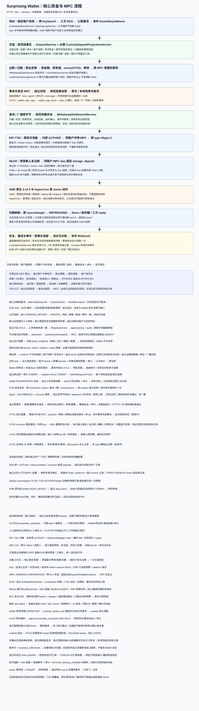

# Surprising Wallet 核心代码流程

## 入口和租户

Controller 校验请求与身份后委托应用 Service；Job 只调度。所有地址、Gas、中继、余额、订单、签名意图和事件都有明确租户。仓储只访问各自业务表，跨表事务由 Service 编排。金额使用最小单位整数或 BigDecimal。

## 原生节点启动密钥流

1. 读取本节点公开证书 SPKI 与配置中的 KMS 资源名、wrappedKey、CA bundle，不读取明文 storage.key。
2. 通过固定 GCE metadata 地址取得附加账号短期令牌；向 Google KMS 请求原 DEK 解包，AAD 固定绑定 SPKI。
3. 验证响应长度与 CRC32C，再把 32 字节 DEK 移交锁页、不可复制的 `StorageKey`，供 `EncryptedStore` 使用；释放时清零。
4. 任一身份、IAM、TLS、校验或锁页错误均停止启动，不创建替代密钥。成功后继续原业务/审批/MPC 流程，不为每笔签名重新调用 KMS。
5. 节点重启必须解包同一 DEK 才能恢复原加密协议记录；数据库、MPC 会话和链上广播状态不因 KMS 接入而改变。

## 地址发布

1. `CustodyAddressService` 校验租户、主体和链配置，固定租户派生坐标。
2. `MpcSigningService` 保存原 key/epoch 建钥描述符；事务外调用三名持有者。
3. 三份公开结果绑定同一租户/key/版本/参与方且公钥一致后，激活 key。
4. `MpcPublicAddressCodec` 仅用联合公钥编码；在原 key 锁下发布 tenant/key/address。重复受理继续原 key，不另建替代地址。
5. Gas 地址沿同一租户地址发布流程创建；XMR 由三名原持有者协同建立原根和子账户。

## 充值、确认和重组

Scanner 观察规范区块与交易；账户链还核对完整成功事件/回执，不能仅凭方法参数入账。已知内部归集、退款和重复日志不得重复计入客户余额。`DepositService` 明确编排 `CustodyDepositProjectionService`：充值记录、流水、余额、租户投影、赤字恢复和持久事件同事务提交，缺失地址归属整笔回滚。

未达确认数保留 pending；后续补确认不受新业务开关或租户关闭链影响。发生重组时核对原规范块，撤销投影或记录赤字，并在赤字未恢复前阻止新提现领取。已观察事实不能因入口停用而丢弃。

## 出款和归集的共同签名边界

1. 原业务行锁下核对租户、状态、原发送者和金额；预留余额、nonce/UTXO、费用及固定载荷。
2. 同一事务创建不可变 MPC 请求及当前 attempt。原 key 必须 ACTIVE，版本与请求一致；刷新中的 key 不受理新 SIGN。
3. 提交后，在事务外向原参与方发起真实 MPC；返回结果按原公钥、原 preimage 和接收方独立验签，并加密保存绑定结果。
4. 从原业务载荷独立重建交易，校验选定签名后提交原文和本地哈希；之后才调用费用 RPC 或广播。
5. 回复丢失保留原请求和已选字节；查询、必要时重放原文，不能替换 nonce、输入、参与方或同业务意图。
6. 规范终态回执确认实际效果、净支出与费用；订单归属/状态/哈希、冻结扣款、条件确认及事件同事务提交，竞争失败全部回滚。
7. 只有明确的链上失败和适用的完整退款证明才能结束并释放资金；未知、缺失材料或不完整回执继续保留原约束。

`CollectionPlanningService` 计算可归集金额及租户目标；`UtxoSelectionService` 在调用方事务中核对并锁定输入；`WithdrawalClaimService` 检查重组赤字后领取订单；`EvmBatchOwnershipService` 防止批次与单笔重复结算。

租户资金池创建账户链提现时，必须解析到已启用的本租户归集/提现来源；缺失时拒绝创建订单，不回退到充值地址。租户 Gas 地址查询按稳定 ID 排序，避免同一租户链出现多个启用地址时查询顺序改变来源。

租户管理员可通过 Console 为指定链设置提现紧急暂停并填写原因，状态与审计在同一事务提交。暂停后新提现在租户链许可检查处拒绝，尚未领取的订单在 `WithdrawalClaimService` 保持原状态，MPC 授权入口拒绝新的签发和 Monero relay；最终授权事务再次锁定并检查链状态。已广播交易仍须继续观察与对账；已发出的独立证明和已经进入原生签名的请求不会因这个开关自动撤销。

备用热提地址准备在数据库事务外完成 MPC 公钥协调；地址发布、`custody_hot_wallet` 备用登记和审计在一个事务中提交。其链地址角色为 `HOT_WITHDRAW`，链扫描到该地址的入款只更新未入账的链观察，不铸造客户余额或充值投影；客户本金池划拨也排除全部热提账户，实际库存另行链上对账。额度按租户、钱包和资产单独保存，仍不产生链上资金转移或新的出款权限。账户链备用地址经独立规则、所有启用资产政策和库存核验后可原子启用；UTXO/XMR 暂不启用。

Console 的热钱包归集规则预检核对原 MPC key、`HOT_WITHDRAW` 链地址角色、全部启用资产的本地政策，并通过 mTLS 向独立审批域逐资产查询预装目的规则。返回的规则 ID、指纹、目的地址及额度仅供启用前核验；预检不更改热钱包状态、不转移资产，也不构成任一归集的签名授权。

热钱包库存刷新从独立审批的多链 RPC 读取实际地址的资产原子单位余额，再在短事务中核对钱包状态和政策未变、保存单调的观察时间与规则指纹，并写审计。刷新不改变 `ledger_balance`、客户权益、提现订单或钱包启用状态。链上余额仍须结合在途链交易预留与最终回执，才能成为出款路由的额度依据。

`CustodyHotWalletService.activate` 在事务外核对独立归集规则与各资产库存，事务内锁租户链及备用钱包，再核对原 key、地址、政策、规则指纹、余额和最高限额后把状态置为 `ACTIVE`。`CollectionAdmissionService` 对每个账户链候选在单事务里调用 `HotWalletCollectionRoutingService` 并持久化原收款目标；后者锁租户链和活跃钱包，结合库存与 `collection_record` 的目标累计流入防止超过单钱包最高余额。活跃路由无新鲜库存或容量时失败关闭；没有活跃钱包且提现未暂停时沿用旧租户归集目标。提现暂停期间仍可向活跃安全钱包归集，但缺少活跃钱包时拒绝归集。已记录流入保守占额，规范链余额锚点释放尚未接入。

Console 应急路由切换先在一个事务中持久化提现暂停和旧钱包本地隔离。归集路由持有租户链共享锁，故事务提交前要么已有归集完成，要么新归集等待并在提交后看见旧钱包隔离状态；随后确认三名原生持有者与独立审批侧的密钥隔离，再启用备用钱包。后一步失败时保留已提交的暂停和旧 key 隔离。返回结果强制标记资产未转移，且不会自动恢复提现。原钱包链上资产、已签交易、委托和授权仍须独立处置。
普通 EVM 已签归集在真正发送原始交易字节时，`HotWalletBroadcastFence` 将租户链共享锁持有到 RPC 返回，复核原归集哈希、源热钱包 key 状态和暂停时的当前安全目标。普通 EVM 提现与 EIP-7702 归集/提现也将原状态复核和 RPC 发送放在该共享锁内。暂停事务在同一租户链行更新，故旧目标的未知交易不能在暂停已提交后新广播。
Aptos、Sui、Solana、NEAR、DOT、TON、TRON、XRP、ADA、HyperCore 的普通业务交易在链上查询仍未知时进入相同的原始归集/出款广播门；它们使用各自已绑定的原交易哈希和原签名 key，归集还核对安全目标与网络。NEAR 注册、DOT/ADA Gas 补充、XRP 地址准备和 ADA 确认重发也受暂停门控制。BTC 类 UTXO 已签队列与 XMR 原生中继先持租户链共享咨询锁，再核对已有行的暂停；XMR 以独立连接在每次持有者 RPC 期间持锁，保留事务外 RPC 边界。历史链无租户行时，控制台暂停在同一咨询锁下创建 `CLOSED` 且暂停的行。其他辅助交易及 UTXO/XMR 热钱包路由仍需逐路径审计。

隔离后的只读库存使用独立审批 `incident-inventory`，独立 key 必须为带原隔离哈希的 `DISABLED` 状态。余额读取器仅在该只读方法中用已登记公钥核对地址，不放宽普通自动付款对 `ACTIVE` key 的要求。Wallet 逐资产核对原钱包地址、key、隔离事件指纹和观察时效，返回配置资产余额且明确 `assetTransferComplete=false`；未知 Token、UTXO/XMR 与实际救援转移仍未覆盖。
EVM 隔离库存还在余额块高读取地址代码：`0x` 为无委托，`0xef0100` 加 20 字节地址为 EIP-7702 委托，其余非空代码标为异常。独立 RPC 在读取后复核该块哈希；Wallet 校验状态、目标地址和区块哈希格式后展示，不能据此宣称委托已撤销或资金已迁移。

账户链新提现在创建原事务中先锁租户链路由状态，再锁候选活跃热钱包，核对独立库存缓存和该地址未决/24 小时预留，插入不可改绑的订单预留，再固定 `withdrawal_order.from_address`、冻结客户账本并保存独立审批意图。任一步失败整体回滚。链上确认、确定失败及独立审核拒绝的无签名取消在各自资金事务中关闭预留；已签或广播未知维持占用。已确认支出也继续扣减缓存库存，直至具备规范链高度与回执锚点的余额观察可证明它已包含在余额内。

托管租户提现订单创建时固定 `from_address`；旧的 UTXO 排队订单可在首次选币时从空值绑定来源。领取签名、标记广播和常规状态推进只能使用已绑定的原来源；数据库触发器拒绝任何后续改写。热钱包切换只影响未来创建的订单，不能借切换将已接受或在途订单转到另一把密钥。

EIP-7702 批量提现的最终中继签名与链上付款权威地址属于不同 MPC key。Wallet 在每次独立授权前及授权回执落库时，同时检查原批次准备载荷中的热钱包权威 key；该 key 处于备用或隔离状态时，中继 key 不能绕过本地熔断。对新广播及未知交易重广播，还在 RPC 提交前检查租户链暂停和原权威 key 的状态；已在链上可见的交易仍可标记并继续对账。原批次及链上委托仍须另行处理，已发出的证明和已签交易不能仅凭本地状态视为撤销。

EIP-7702 批量归集也逐项解析原准备载荷的资产权威地址，签名前核对全部原 key；首次广播及未知交易重广播前再核对原权威 key 未隔离。暂停期间逐项核对原交易收款地址是否仍为活跃且归属完整的安全钱包。链上已知交易仍按原批次对账。提现暂停时，普通归集只有目标为当前活跃且地址/密钥归属完整的热钱包才可继续申请独立授权；授权回执落库时在租户链共享锁下复验目标，旧或任意外部目标均拒绝。Monero relay 与非归集业务仍被暂停。

备用地址登记同时固定原 MPC key ID。隔离先将对应登记行推进到 `QUARANTINED`，保存不可变原事件并审计；Wallet 新授权在独立服务调用前和最终落库前再次检查地址状态。Wallet 经 mTLS 向三名原生持有者分别送出事件哈希，各持有者持久拒绝该 key 的签名、重入和在途协议结果提交，仍保留原结果只读查询以便对账。三名回执匹配后，Wallet 再将原事件送到独立审批域，后者锁定并禁用 `approval.key`、保存事件哈希和审计；四个回执全部确认后 Wallet 记录熔断确认时间。跨服务失败保留 Wallet 隔离及待确认状态，Console 和 custody 定时任务可按原事件重试；不能经 Console 重新激活。已产出的签名、已广播交易和链上授权仍须按原业务引用恢复、撤销授权或对账。

## UTXO 与 PGMQ

UTXO 批处理同时编排提现与归集。原订单、输入锁、`chain_signing_transaction` 的初次入队持久凭据及 `wallet_mpc_sign` 入队一起提交；凭据在队列/归档清理后保留。

MPC 签名 Service 在事务外调用持有者，完成后按 `read_ct` 栅栏提交原结果及 `wallet_sign_done` 消息、归档原消息。广播器核对原请求及独立重建的选定交易，再广播；RBF 继续绑定原业务与明确的新替换意图。签名节点不连接 PGMQ 或钱包数据库。

## EIP-7702

原批次领取锁、固定准备数据、中继 nonce、内层 AUTH/OP 意图和 SIGNING 状态一起提交。业务授权密钥属于原业务租户；中继与业务授权密钥必须属于同一原业务租户，引用同时绑定该 tenant/batch；独立授权不接受跨租户共享中继。事务外 MPC 内层签名后独立重建载荷和 unsigned 费用估算；中继 MPC 意图与原租户 Gas 先提交，选定外层 type-4/type-2 原文及哈希后广播。两类 Job 共用链/网络领取锁。

丢回复或停用新任务时优先恢复原批次快照、原签名及哈希，不重新领取，不使用本地 Credentials。部分条目失败按原批次结果处理，成功条目不能再次扣本金或手续费。

## NEAR 自动存储注册

Token 收款人未注册时，原业务锁下以同租户 MPC Gas 受理固定 `storage_deposit(account_id=原收款人,registration_only=true)`；Gas nonce、FUNDING 意图、待完成链记录及 ADDRESS_PREPARATION 冻结一起提交。事务外签名，选定 raw/hash 提交后广播。

完整 FINAL、全 receipt 图及规范 header 分别校验合约押金退款、系统余额退款和 Gas 退款；实际支出为 tokens_burnt 合计加附加押金、减已完成押金退款，不能再次减 Gas 退款。注册及 Gas 结算完成后才受理原 Token 付款；明确失败且押金完整退回时，费用结算和原业务结束/本金释放同事务完成。已有注册意图不能被当前已注册状态跳过。

固定 NEP-141 模板显式 build 退款 Promise；退款日志不能替代实际回执。恢复 RPC 绑定原 payload.network/genesis，停用不改写原意图。

## XMR 与 HyperCore

XMR 使用 Monero 原生 2-of-3。三名持有者各自保留私有钱包，Java 保存公开地址、原支付策略及已核验结果。扫描核对原输出位置、解锁和规范区块；出款/归集核对原 txset、实际费用和找零。恢复只使用原两名持有者的原审核、artifact/cosigned 材料；材料不足保持未知，不重新 transfer/sign 或导出随机材料。

HyperCore 以原 owner、网络、动作及固定金额签名；真实入金、出款和归集按链上余额及账本核对。测试网认证通过不是转账通过，最终矩阵必须使用原已保存且有资金的 MPC 身份。

## 份额刷新

原 sourceEpoch、三名持有者、actor/reason 受理刷新；key 锁下先确认没有未完成 SIGN，原 REFRESH 与 REFRESHING 同事务提交。原生接受先写旧版本 fence，新份额另写 N+1；持有者专用 mTLS 就绪端点核对三份实际持久材料，之后才写 ready 和原完成结果。

Java 事务外恢复原 targetEpoch，只有三份同公钥绑定结果才同事务激活 N+1、退役 N 并恢复 ACTIVE。已完成旧 SIGN 仍可读，新的旧版本 SIGN 拒绝。新份额已完整持久时只重做公开就绪检查；缺失私有协议材料时保持冻结，不回退旧签名或换仪式。公钥及公开地址不变。

## 事件、回调和运维

`CustodyEventService` 随业务事务写事件；API 来源生成 Webhook 投递记录，Console 来源仍记录事件。Webhook 由独立执行器派发。费用、重放、原请求恢复和结算都保留审计路径，任何余额变化可通过流水对账。

每类 Job 使用独立线程池。Java 只运行 API 与业务调度，原生三名签名持有者分别部署。版本回滚保留最新业务状态和协议记录；材料备份、隔离恢复及未知处理见 [运行说明](../../infra/mpc-signer/OPERATIONS.md)。

各链实际验证结果与命令见 [MPC 服务说明](../../infra/mpc-signer/README.md)。当前清理后的干净构建、121 项定向检查及隔离工作目录中两轮真实可执行 JAR 无 Seed 启动已通过；完整备份恢复与所有链最终业务回归通过后才能提交和推送。

## 租户子账号权限变更

租户管理员认证 → 验证当前管理员归属与启用状态 → 锁定同租户子账号 → 更新角色/状态或密码 → 撤销该用户全部有效会话 → 写入同租户审计 → 一起提交。审计失败全部回滚；平台账号和 API Key 不能借此创建租户管理员。独立审批、规则命中和节点授权各有独立校验，不因拥有 APPROVER 角色而直接放行 MPC 签名。

## 独立审批规则和决策

独立登记租户/审核员 → 独立管理员设置链与资产规则 → Wallet 固定提币业务意图 → 审批服务锁 tenant 行 → 读取单表策略、24 小时请求金额和原收款人 → 写 request 与 audit → 命中场景时 PENDING，未命中时 APPROVED。未配置策略或未登记租户时拒绝签名授权。审核页面仅在独立身份认证后调用审批接口，Wallet 普通子账号权限不能替代此认证。

审核决策 → 锁同租户 request → 比对意图哈希、排除自审/过期 → 写入不可改写的单审核员 decision → 达到人数时 APPROVED，任一拒绝为 REJECTED → 审计一起提交。重复相同决定幂等，改写已有决定失败。已开始签名的原请求保持冻结和恢复路径，不因审核超时释放。

强制边界为：最终链交易独立解析、匹配业务意图/费上限 → 签发原 session/key/epoch/message 授权 → 每个 MPC 持有者验签并持久绑定 → 原交易广播/恢复。Wallet 自动推进与外部状态投影也遵循该边界；业务审批结果本身不能作为可直接签名的凭据。

原生节点授权入口（已实现，待整体联调）：mTLS 调用者租户授权 → 拆出独立证明 → 验证 Ed25519 与 session/tenant/key/epoch/algorithm/online/messageHash → 加锁检查首次有效期或原授权接纳记录 → 检查节点容量 → 原授权 ID 和 session 双向不可覆盖持久化 → 原 request 持久化 → MPC 协议。无证明、消息变化、授权重复用于另一个会话均拒绝；读取原结果不产生新的签名。

独立审批过期扫描由 `ApprovalExpiryJob → ApprovalExpiryService → ApprovalWorkflowService.status` 执行，每 5 秒一次，绑定单独 `approvalExpiryScheduler`。每笔请求分别事务处理并保留审计，已开始签名的请求不进入过期取消。金额 API 字段使用十进制字符串，浏览器不以浮点数处理金额。

独立登记流程：可信审批主机 0600 文件 → Enrollment CLI → 同事务登记独立 tenant/member 与 audit → 独立登录 → 策略设置与审核；CLI 不启动 HTTP，不复用 Wallet 密码，也不覆盖已存在身份。

EVM 最终交易校验基础：`EvmWithdrawalVerifier` 直接使用 SDK 解码规范 unsigned wire，重新计算摘要，并匹配独立注册的 key/epoch、链 ID、Token 合约/精度、实际原生币或固定 ERC-20 transfer 收款人和金额，以及审核费上限与独立费上限。它不信任 Wallet 声明的交易语义；EIP-7702 必须走专用批次策略，不能经普通付款路径放行。独立公钥登记、普通 EVM 授权和 Wallet 消费已接入；Aptos 由下述专用校验器处理，其他族通过规范交易与独立事实用例验证；实网部署仍须核验对应节点和资产配置。

公开提币状态投影：核心订单 `PENDING_REVIEW` 保留资金冻结和不可领取签名的内部语义；`PublicWithdrawalStatus` 在创建响应、永久幂等凭据、列表/分页/原请求查询以及事件投影统一显示 `FROZEN` 并隐藏审核等待原因。`custody_withdrawal` 保存公开状态，使状态过滤与分页数量一致；确认投影比较公开状态，不因内部审核等待反复推进或生成审核 Webhook。对外不提前伪造 SENT、交易哈希或确认。独立审批页面仍显示真实审批状态。

新策略默认启用“全部提币需要审批”（ALL_WITHDRAWALS），独立管理员显式关闭后才按单笔/24 小时累计/新收款人/控制台规则放行免审请求。策略 API 必须明确给出 allWithdrawals，缺省值不得悄悄变成免审。独立站退出时撤销旧策略请求并清除旧租户页面状态，迟到响应不能填入另一个租户会话。

独立公钥登记：服务客户端提交原 CREATE_KEY/REFRESH 描述 → ApprovalNativeRegistryClient 使用审批域自己的只读 mTLS 身份直接查询三名固定持有者 → 全部完成且公共身份一致 → ApprovalKeyRegistryService 短事务锁独立租户/公钥 → 首次 epoch 1 或保持同一公钥的连续刷新 → approval.key 与审计原子提交。未配置独立持有者访问时登记拒绝；调用方不能提交结果 JSON 替代实际观察，禁用公钥也不能由 Wallet 重新启用。普通 EVM 与经典 Aptos 的交易授权签发已接入，其他族也使用显式校验；验证范围见 [审批验收记录](approval-validation.md)。

原生授权受理增加首个不可覆盖 admission 证据：在协议启动前先持久化原描述与证明，再写授权 ID / session / request；受理与 ABSENT 查询共用节点锁，首次有效期在锁内按当前时间核验。任一步骤崩溃后已有 admission 的会话返回 INTERRUPTED，不能被误当成从未受理而退款或新建付款；相同原证明可在恢复时补齐持久记录，实际密码协议仍最多启动一次。测试专用故障节点不进入 Runtime 发布包。

独立资产/网络配置由审批主机持有（ApprovalAssetRegistry），Wallet 服务客户端不能编辑。受理时把网络身份、Token 合约/标识、精度和全局费用上限冻结到 approval.request.asset_snapshot，审核哈希同时绑定业务事实与该快照。金额/费用必须符合独立精度，费上限不得超过独立配置；缺少资产配置时拒绝受理。原请求幂等回放保留原快照，当前资产配置变化不得悄悄改写既有审批；审核页面展示原资产/网络标识及费用币种。

审批规则与 24 小时累计窗口按租户、链、网络、资产分别隔离。独立管理员必须为已注册网络显式创建规则；测试网规则不能用于同币种主网申请，主网/测试网金额不混加。

共享不可变协议由 common 承担：MpcSignCommand、WithdrawalIntent、ApprovalAssetSnapshot、SigningCandidate 和 SigningAuthorization；两应用直接依赖共同契约。独立 issuer 私钥只在审批域加载，Wallet 和持有者仅持验证公钥。

最终普通 EVM 提币授权：实际 mTLS → 租户锁 → 原签名槽与 session 查重（同 session 返回原证明）→ 审批状态及期限 → 当前独立资产快照/登记公钥/固定持有者 → 解码原始 EVM wire，核对收款人、金额、合约、网络和费用 → 锁定唯一账户/nonce 与业务订单 → 原子保存 signing_transaction/version/slot/grant、request.signing_transaction_id、原生费用累计预留、审计 → COMMIT → 返回独立证明。申请已过期则提交 EXPIRED 后返回状态，不产生签名授权；一旦绑定签名交易则不得因期限或网络超时清除绑定。原凭证过期仅返回原件供已经受理的持有者恢复，不延长时间，不换 session/nonce 生成新付款。未实现独立解码的链、替换版本和自动操作拒绝签发。普通 EVM 的 Wallet 凭证持久化与真实节点调度已通过验收，其余交易族仍在建设。

永久收据不允许 UPDATE/DELETE，原审批交易绑定不允许清除或替换。独立费用额度按网络原生币原子单位累计；窗口内遇到不同的网络身份/币种/精度直接阻断，新配置不能把旧预留解释成另一种单位。

Wallet 新提币（API/Console 同路径）→ 校验并冻结本金 → 创建内部 PENDING_REVIEW 原订单与公开 FROZEN 托管记录 → 预留 Gas → 保存不可改写 wallet_withdrawal_approval 原申请 → 永久接受响应/审计/事件一起提交。后台 WithdrawalApprovalJob（withdrawTaskScheduler）→ 事务外提交/查询同一独立申请 → 锁本地收据与原订单 → PENDING 保持冻结，APPROVED 放行 FROZEN 等待链准备，REJECTED/EXPIRED 仅在订单尚未签名/提交时同事务释放原本金、投影 Gas/公开 FAILED 及事件 → 审批收据与审计提交。网络失败不丢申请、不退款，后续使用同一申请重试；迟到的 PENDING 不覆盖 APPROVED。已开始签名的独立申请不可过期，已领取或未知的本地交易不因审批拒绝/过期释放。普通 EVM 与经典 Aptos 的证明获取/持久化/消费已实测；其他族也走各自显式校验器，验证范围见 [审批验收记录](approval-validation.md)。

原准备命令与原 native descriptor → MpcAuthorizationService（事务外独立 mTLS）→ 签名与 reviewed businessHash/chain/network/slot/session 校验 → 原证明 + MPC.AUTHORIZE 审计 COMMIT → 原尝试 RUNNING dispatch fence COMMIT → MpcSigningService.exchange 只以 submit(Request,Proof) 执行 SIGN → 每个持有者独立验签/首次验期并持久受理 → 原结果读取与密码签名核验。Wallet 重试使用同一持久证明和原 session；无证明或未实现交易核验器时不接触原生 SIGN。admission-only 崩溃恢复允许重送原请求/原证明，原生节点自身仍保证已启动的普通密码协议不重执行。经典 Aptos 与独立公钥登记消费已实测；其余非 EVM 核验器和 Monero relay 仍在建设。

Wallet 三持有者 ceremony 完成态 COMMIT → 原 CREATE_KEY/REFRESH 描述提交独立登记 API（无 Wallet 数据库锁）→ 审批域实际只读 mTLS 查询三持有者 → 公钥/租户/group/algorithm/epoch 校验 → approval_registration 与 MPC.KEY_REGISTER 审计 COMMIT → 地址发布/新签名/后续刷新可用。登记失败不抹去已有 DKG，也不生成新密钥；重试原描述。已保存登记回执时不重复查询持有者；第三台离线不影响已登记原公钥的两节点签名。

普通 EVM 显式恢复：原 Wallet 签名请求保留 command/nonce/业务单 → 保存新的 native attempt 与 replayActor/replayReason → 独立授权服务查原槽 → 已存在同 session 则返回原证明（执行描述和审计也必须相同）；新 session 则检查显式审计、原审批、完整原命令/版本、同一账户 nonce 和当前登记公钥 → 新 grant + SIGNING.AUTHORIZE_REPLAY 审计 COMMIT → Wallet 保存该尝试的原证明 → 新 quorum 签同一个原交易。原交易/版本/槽/费用预留均只有一份；原 session 和原凭证永久保留，不因恢复创建另一笔付款。更换 nonce/载荷、无审计换 session、修改已受理 session 的参与方均拒绝。

Aptos 独立授权边界：公开 BCS 编码与地址工具统一放在 chain-sdks/sdk/signing/aptos，AptosSigningPayload 放在 common.signing，审批服务不得依赖 wallet-api。ApprovalWithdrawalVerifiers 按明确交易族分派 EVM/Aptos 校验器；Aptos 仅接受普通账户 sequence 的 legacy Ed25519 APT / 已登记 primary FA 转账。独立核对 sender 公钥、网络 chain ID、收款人、原子金额、metadata、有效期及 maxGas×price，并重建规范 BCS 与真正送往持有者的全部字节比较；脚本、代付与 orderless 不放行。相同原命令/sequence 的显式新会话恢复保留一个原交易/槽及手续费预留，不允许换 sequence 付款。Wallet maxGas 按配置的总原生费预算除以 gas price 向下取整，不使用会越过审核费限的最小 gas 下限。此编码分层调整不新增表、字段、状态或种子配置，init-sql 无额外变化；Aptos 原生币的独立两人审核、Wallet 证明/审计持久化和两持有者签名已实际通过（第三台离线；未广播）。

独立审核员日常管理：可信主机仅负责最初 TENANT_ADMIN 登记，独立管理员随后通过自身会话/Origin/CSRF 邀请绑定 Wallet 子账号 UUID 的 APPROVER。approval.member 保存 INVITED/RESET_REQUIRED/ACTIVE/DISABLED、激活能力的 SHA-256 与 24h 到期时间（不保存原令牌）；原令牌只返回一次，页面分享链接放 URL fragment。审核员自行设置独立密码后才能登录，激活原子消费且不自动建立会话。重新签发立即使旧链接失效、阻断旧密码并撤销原会话；停用清除激活能力并撤销会话。不可通过浏览器修改自己或其他 TENANT_ADMIN，也没有 Wallet/mTLS 创建或重置审核身份的入口。成员变更和审计同事务，管理员可按租户分页查询原始决策、规则与成员审计。决策使用 member FOR SHARE，与停用/重置排队，防止停用已提交后仍接受旧身份决策；不占用租户 admission 锁。成员、会话、审计仓储仍各访问一表；init-sql 同步成员字段/状态与分页索引。成员管理后端回归及真实 HTTPS 激活/撤销/审计已通过，前端 58 项 DOM 交互测试与构建已通过（未部署）。

UTXO 独立链事实查询（批次授权接入验收中）：ApprovalUtxoRpcProperties 仅从审批主机安装的 chain/network/genesis/只读 RPC 配置绑定；ApprovalUtxoRpcClient 不依赖 wallet-api、不访问钱包表，在任何数据库事务之外调用 getblockhash(0)、getblockchaininfo、gettxout(include_mempool=true)，逐项核对网络、同步状态、原输出金额/锁定脚本与同一 bestblock。金额 JSON 精确保留十进制并转原子单位，缺失/已花费/低确认或观察跨 tip 拒绝。仅 HTTPS 或本机 loopback HTTP，禁止 URL 凭证/query/fragment、禁止重定向，全次观察有总超时与单回复 2MiB 上限；Basic 只读凭证来自 0600 非符号链接文件，不放公共资产快照。此客户端只在首次批准批次的事务外提供链事实；签发必须再完成全部付款/输入/找零校验及永久绑定，单独查询成功不构成授权。本次新增配置/查询组件不改表或初始化种子，init-sql 无额外影响。

UTXO 公开交易校验分层：UtxoSigningPayload 移入 common.signing，所有输入槽共享固定 task/unsigned/keyIds，并显式绑定 changeKeyId；Wallet 保留原批次事务，准备与恢复均检查找零地址由同租户已登记的活动 MPC key 派生。地址派生和输出脚本归 chain-sdks 的 MpcUtxoTransactionCodec，Wallet 与审批端共用公开编码。UtxoWithdrawalVerifier 在独立模块核对批次每笔付款的审核哈希、同一原资产快照、收款脚本和精确金额；逐输入比对只读节点原输出金额/脚本与已登记公钥、租户及当前槽 key/epoch；重建整笔 unsigned wire 并核对真正的 SIGHASH_ALL/ALL|FORKID 摘要。整笔最大费不得超过各批准请求费额合计及独立网络总费限。原生交易金额与精度固定8位，并冻结 utxo:genesis 网络身份。该校验器已接入批次签发，原输出事实、逐输入占用和单次费用同事务编排；真实四-Core 广播与策略测试的覆盖范围见 [审批验收记录](approval-validation.md)。此次公开载荷与编码分层不改 SQL 表/字段/种子；旧类需 clean 清理，DB 基线无额外变化。

UTXO 精度在共享 Asset 构造时即限定8位，校验器先检查族/数量/精度再做金额计算，拒绝 null 与异常精度载荷。Wallet 输入与找零的所有 key ID 合并去重后按固定 UUID 顺序锁定，再按原输入顺序生成签名槽，防止不同批次交换输入/找零角色产生锁顺序环。此边界收紧无 SQL 基线变化。

UTXO 固定批次授权事务：SigningCandidate 审批 ID 统一排序，common.ApprovalTransactionHash 以全部原审批 ID/审核哈希与实际载荷版本生成 V2 businessHash，所有输入槽共用该哈希，原生凭证格式仍为 SigningAuthorization V1。ApprovalSigningService 先短事务检查审批与原槽；未批准/已拒绝/已过期不读取节点。首次批准批次由 ApprovalUtxoRpcClient 在数据库事务外读取，返回后再次锁租户、核对当前原审批/资产/登记输入与找零 key，并拒绝已超过30秒的首次观察。原父业务使用 utxo:task.transactionId，requestUUID 保留为原生版本分组；替换版本仍拒绝。首次授权同事务创建 signing_transaction/version、全部审批绑定、单次 fee_reservation、当前 input slot/grant 与审计；新增单表 approval.spend_lock 逐个永久占用 outpoint，部分重叠输入也不能被另一批次复用，任一步失败一起回滚。approval.signing_version.chain_evidence 保存独立观察原件；后续输入和显式原载荷/原输入恢复只读取该原件，不因链上已花费或原审核期限已过再取新事实。每输入槽只认一个 Wallet request ID，每 native session 只认原证明，不给别名槽重复授权。SpendLockRepository 只操作 spend_lock，其他单表边界不变，收据均由不可改写触发器保护。

Wallet MpcAuthorizationService 对 UTXO 从公共 UtxoSigningPayload 的全部 payment.reference 装载原 Wallet 审批收据；必须全部就绪、哈希与快照一致，独立证明须绑定全部订单与该固定版本。原证明和 MPC.AUTHORIZE 审计提交后才允许 MpcSigningService 调度持有者；一笔就绪不能替代全批就绪。此批次接入新增 spend_lock 表/索引/触发器、signing_version.chain_evidence 及 UTXO 非空约束，init-sql 同批同步；没有向 Wallet 暴露原链事实写入口。当前新增路径待数据库/真实节点验收，其他未实现交易族仍拒绝签发。

### 本轮全链授权编排（统一验证进行中）

Wallet 原提现/批次 → 全部原审批收据 → SigningCandidate → 独立账户/UTXO/原生节点只读事实（无数据库事务） → 短事务重新检查审批、资产、公钥/epoch 与实际 wire → 一份原交易/版本/费用 + 每输入/nonce 永久占用 + 多签名槽/原证明 + 审计 COMMIT → Wallet 证明/审计 COMMIT → native dispatch fence COMMIT → 每个原持有者验授权执行。

Solana payer/source、UTXO inputs 和 EIP-7702 AUTH/OP/relayer 是同一原交易的不同槽，费用不能重复预留。EIP-7702 版本只按共同原 plan 生成，最终外层仍单独验证完整 wire 与有效内层签名，不以 plan hash 替代交易检查。Sui 对象锁包含 ID/version；ADA 原 outpoint 锁与独立 CBOR 输入一致。DOT 只读 signing-facts 从独立 RPC URL 查询规范 reference/runtime，不使用 Wallet 提供的网络端点。

XMR 原已完成 SIGN/grant → 持有者实际原 artifact READ_RESULT → 固定 signSession/intentHash/transactionHash/holder → 独立 relay proof + 审计 COMMIT → wallet_mpc_relay 原描述/证明 + Wallet 审计 COMMIT → 原持有者 MONERO_RELAY(Request,Proof)。relay session 固定，断网复用原证明；它不创建第二笔 PAYMENT，不新增费用预留。

UTXO 完成签名的原 epoch 在份额刷新后仍可读取/装配；未完成请求不得用旧 epoch 开始新 SIGN。手续费模型、各族与恢复状态按统一入口验证，自动路径受独立准入限制；规范消息用例不代表实网广播，见 [审批验收记录](approval-validation.md)。

### 自动用途授权（新增代码，未统一验证）

Wallet 原 COLLECTION/RECOVERY/DEV_FAUCET → 空人工审批 ID 的 SigningCandidate → 独立主机用途规则 + 真实来源/固定 treasury 身份 → SYSTEM 用途收据 → 同族规范 wire/链事实校验 → 源间隔/本金/次数/永久原生费用额度 → automatic_operation + 原交易/版本/槽/证明 + 审计 COMMIT → Wallet 原证明 + automatic_operation + 审计 COMMIT → native SIGN(Request,Proof)。人工提现仍必须有真实审批 ID，不能转成此路径。

EIP-7702 collection 原计划 → 所有来源 AUTH/OP / 已登记 relayer → 独立 collector/delegate code 和 nonce 事实 → 最终完整 collectBatch ABI + 全有效签名/tuples → 一个原批次及一次费用。

NEAR 原已获批 Token 付款 → 固定父业务准备引用 → 独立确认未注册/最低押金/父来源实际 Token 余额 → 固定 Gas FullAccess nonce 和规范 storage_deposit Borsh → 押金 + 费用额度 + 父准备 scope 永久绑定 → 原证明执行。通用 Gas 缺口、父归集预登记及 XRP 信任线准备仍在补齐，缺少显式验证时不得先放行再补证据。

### 全链签名授权边界

父归集预登记使用独立 mTLS `POST /approval/service/v1/automatic-plans`：Wallet 仅提交租户、公钥 ID、固定业务引用、资产、收款人与金额，XMR 额外提交原观察描述。独立服务在事务外读取真实来源余额，事务内固定规则、公钥/treasury 角色、收据、原计划及证据，并一次预留金额/次数/最大原生支出。`approval.automatic_operation.transaction_id` 在这一阶段为空，计划和观察必需；数据库触发器只允许一次空值到真实交易的绑定，其余字段永久不可改写。后续最终 wire 授权绑定原计划，不能重复扣额度或更换来源/收款人。ADA、DOT、NEAR、XMR 的 Wallet 准备流程在发起 Gas/注册前先取得该收据。

`ApprovalOperatingBalanceReader` 按链显式查询资产和原生可用余额；不接受 Wallet 余额、节点地址或凭证。通用 Gas 授权同时要求已批准的人工作业或预登记且仍未签名的归集父业务、实际父资产本金、原来源/目标以及真实原生储备缺口。来源须覆盖本金和预留原生支出；Solana 单独核验 Gas payer。ADA/Sui 由真实输入验证覆盖来源余额；7702 归集由自身观察覆盖每个来源和 relayer。XMR 原观察需匹配独立 daemon 的网络/genesis/规范区块，并由只读身份直接取得两名原持有者的已完成结果，允许的高度差最多 10；这不是无条件的实时可用余额保证，最终 native payment 仍须验证真实选币和费用。Monero Digest 计算移到 SDK，仅支持独立安装凭证的一次挑战重试。

XRPL 账户设置使用独立 `ADDRESS_PREPARATION` 用途。SYSTEM 收据本金为零，人工提现与其他自动付款仍要求正本金；激活 Payment 的真实 XRP 转入额连同手续费计入永久原生支出。独立验证固定租户目标公钥和 `prepare:<key>:<symbol>:fund|trust`、发行方/币种、同一 validated ledger 的账户/信任线/准备金、独立安装的 Gas 地址及 trustLimit。激活只能补真实储备缺口；TrustSet 只能设固定限额及 NoRipple，不能改已有启用/有余额/冻结信任线，不能夹带付款、路径、标签、授权或其他字段。Wallet 对相应用途的 Gas 预留与结算保留同一审计链。新增用途及零本金例外已同步唯一 init-sql；不新增业务表。

EVM 所有签名槽追加独立费用事实：配置显式 feeModel、最大签名大小，OP Stack/Scroll 额外配置原生预留及报价余量。独立 RPC 校验 chain ID 和规范块，再读取 L1/operator 费用；7702 在首个内层签名时按整批大小/最大 Gas 预留，最终外层不得越界。总支出包含执行费及额外原生预留，并参与审核上限和一次费用/永久自动曝光。Arbitrum Nitro 不重复加已在 Gas 内的 L1 部分。此预留与报价不构成链上绝对费用上限。参考 [OP GasPriceOracle](https://github.com/ethereum-optimism/optimism/blob/develop/packages/contracts-bedrock/src/L2/GasPriceOracle.sol)、[Scroll 费用规则](https://docs.scroll.io/en/developers/transaction-fees-on-scroll)、[Arbitrum Gas 说明](https://docs.arbitrum.io/arbitrum-essentials/how-to-estimate-gas)。

Bitcoin 类链通过 `ChainType.isBitcoinLike()` 分派；ADA 的 UTXO 模型不再误入 BTC 格式，保留自己的 CBOR、UTxORPC 和金额/输入规则。XMR relay 在原持有者不可读时可尝试另一名原持有者，仅为原 transactionHash 发证明，不新建 PAYMENT；非通信授权拒绝不按成功处理。RBF、无授权终止、撤销传播及部署边界均纳入当前验证入口。策略测试、实际原生协议与实际广播是不同证据；各自覆盖范围见 [审批验收记录](approval-validation.md)，不沿用旧 MPC 验收宣称新审批实网通过。

### BTC 同输入费用替换

独立 BTC RPC profile 可以显式安装 `maximumRbfVersions`（根版本计入，最多 5）、`maximumRbfFeeRate`（最多 1000 sat/vB）和 `maximumRbfFeeAtomic`（最多 100000 sat）；缺失/零值拒绝替换，不会隐式沿用 Wallet 配置。启用时原始签发一次预留全部审核允许且不超过独立资产上限的手续费；后续候选必须严格增费、满足输入金额 10% 限额且不超过原永久预留，不重复计算费用或额度。其他链不借用此规则。

`UtxoReplacementVerifier` 从永久版本重建原审核 ID/哈希绑定，核对原批次 ID、租户、所有 outpoints/金额/脚本/公钥、change key/address、dust 和业务类型；不能增删或重排输入，也不能更换已审核提现收款人或金额。自动归集必须保持唯一原 treasury，净输出只准减去相对根版本增加的确切费用。各版本采用自己的 V2 businessHash，原交易保留根绑定，全部版本与原输入占用、一次费用和审计关联；原输入证据不会因交易已在 mempool 而被重读为“未找到”后放开。它们花费完全相同的输入，在同一规范链上互斥。

Bitcoin 类自动操作收据使用稳定 `utxo:<transactionId>`，各 Wallet 签名请求仍各用自己的 request UUID。归集 RBF 沿用原较大本金曝光，仅扣实际新增费用，不重置金额/次数/永久费用额度。每个版本仍按 input slot 唯一绑定 Wallet ID，原 session 的证明不可改写；新版本另存不可变 receipt 与 `SIGNING.BTC_REPLACEMENT` 审计。该路径源码已编译；真实替换授权/原生签名/节点广播仍需验收。无授权安全终止和撤销传播见下文；已授权短有效期/部分失败/未知交易仍需保留原绑定并对账，不得自动重付或退款。

### Wallet 子账号撤销传播与部署隔离

Wallet 在同一子账号状态/角色、会话撤销和审计事务中，向 `custody_tenant_user` 记录递增的 `approval_revocation_sequence`、待传代次、原操作人及时间；APPROVER 被移除或账号停用触发，重新启用不会清空待传记录。`job/custody/ApprovalMemberRevocationJob` 独立绑定 custodyTaskScheduler，委托 Service 分页读取后在事务外使用真实 mTLS 发送，短事务应用匹配回执并审计。每轮有时间/数量边界，失败保留原代次重试。新证明申请在本租户仍有待传撤销时暂停；缓存原证明继续保留用于原交易恢复。

独立 `ApprovalMemberRevocationRepository` 只访问新增 `approval.member_revocation`，审批域目前共 16 张业务表。最高代次与原描述/hash 永久保存，触发器禁止删除、换租户/成员或回退代次；即使成员尚未登记也保留 fence。新代次在租户短事务内记录 fence、锁定成员、清空 APPROVER 激活能力、停用凭证、撤销会话并审计；成员更新锁与决定的 FOR SHARE 排队。相同代次必须原描述完全一致，旧代次只返回最高回执，不重复停用已经明确恢复的身份。可信主机管理的 TENANT_ADMIN 不能被 Wallet 服务客户端降权。

独立管理员邀请/重置时必须显式确认当前 Wallet 撤销代次。页面列出 walletRevocationSequence；邀请前查询同租户 fence，存在撤销时先要求独立管理员核实本人及当前 Wallet 状态并勾选恢复确认。恢复仍通过独立一次性能力和本人设置密码完成，没有 Wallet/mTLS enable/reset/enroll 路由。传播为跨进程持久重试，不能称为即时跨域原子撤销，也不能声称撤回已签发证明或先前有效审核；停用的是后续身份使用。API/业务用户仍只看到 FROZEN 等正常处理状态。

`common.security.DatabaseRoleIsolation` 只读取 PostgreSQL 18 系统目录，在 Wallet 与独立审批的 ApplicationRunner 中检查真实有效权限：runtime 非管理/非 DB owner/无其他角色成员资格与 CREATE；Wallet 不得访问 approval，审批不得访问其他应用关系、创建应用对象或调用外部 SECURITY DEFINER 函数。检查没有生产旁路开关，失败即启动失败，不在启动时创建/改动角色。独立 schema 由单独 NOLOGIN owner 所有，runtime 仅获业务 DML。

新增 `resources/infra/approval/` 仅提供可审阅部署材料：角色/授权脚本（不建库、不建表或服务）、独立 OS 用户 systemd、无已登记服务证书的公共代理、私网直连 mTLS、只读 native 身份与 issuer 分离、故障/回滚/备份说明。唯一表基线已同步上述用户字段、索引和新单表/触发器，架构边界映射同步新增仓储；没有更改生产角色或部署服务。HTTPS 验收在自己的临时库中配置互异 owner/runtime 与密码；前端、原生授权和受限角色 HTTPS 有各自验证入口，实际覆盖范围见 [审批验收记录](approval-validation.md)。无授权终止见下文；已授权短有效期/部分失败交易继续保持原绑定。

### 未获授权的取消与序号预留（源码实现，未统一验证）

`MpcSignCommand.businessReferences` 将单笔、Bitcoin 类输入和 7702 全批次的业务归属统一为最多 100 个去重引用。在首次 native 请求/尝试事务中同时写入 `wallet_mpc_sign_request.business_references`（数组与 GIN 索引），随后不可改写。清理按真实成员及批次业务引用取齐所有签名槽，不能靠缺失 tx_hash 或某一输入槽判断没有授权。

`WithdrawalApprovalService` 对 EXPIRED/REJECTED 且尚未清理的订单继续轮询，重新通过原 mTLS 读取独立服务状态，核对原意图、资产快照哈希及 `signingStarted=false`。`UnsignedWithdrawalCancellationService` 在原订单事务内锁定相关 native 请求、UTXO 原批次、7702 原批次及相关订单；任何原证明、完成签名、已保存原交易/广播尝试、不同活跃计划的占用或状态矛盾都会保持冻结。一个过期成员不能撤销不包含它的其他原生命令；所有准备命令必须确实绑定该终态意图，才能确认此后独立服务也不会再授权它们。

满足以上条件时，同一事务保存各请求的不可改写 `CANCELLED` 与原独立终态收据、停止未广播批次、释放仅属原 UTXO 批次的输入、将其他仍未出款的批次成员恢复 FROZEN、释放可退批次 Gas，再条件确认 FAILED/退款。本金、Gas 投影、普通失败事件、审计和 `terminal_cleanup_complete` 一起提交；失败全部回滚。CANCELLED 请求不能再绑定尝试、签发/保存证明、分派协议或阻塞 key refresh。终态/清理完成不能回退，原请求和收据永久保留。自动 Gas/注册的已授权子业务不因母提现取消而被伪称未执行或退款。

账户序号与 EVM nonce 现在各用原单表的 `pending_owner` 与 `pending_sequence/pending_nonce` 记录唯一尚未获授权的业务。owner 固定为 tenant/businessType/businessReference；7702 relayer 预留属于整个原批次，不属于某一个 authority 签名槽。分配在单条 SQL 中先取得 owner 范围事务锁，再执行原子 UPSERT，避免首次并发重试在两个唯一索引之间误冲突；同 owner 在受理前幂等返回原值，不同 owner 收到 `NONCE_ADMISSION_PENDING`，7702 工作流保留原 LOCKED 批次重试。第一个真实 issuer 证明与 `MpcNonceAdmissionService` 的准确 wire/key/nonce 受理同事务保存后，才允许后续业务预留；同批后续槽/会话以已保存且验签通过的同版本原证明确认已受理。

这一约束使无授权取消时不会已有后续序号分配。清理只能交回该排他 owner 自己的未受理末端预留，且不低于已观察的链序号；不会回退其他已受理交易。没有使用可任意重排的空洞列表或旧模型兜底。HyperCore 的时间戳通过单独的 timestamp 预留，不按连续账户序号处理。所有新增字段/索引/状态/不可变约束已同步唯一 init-sql；没有新增业务表。

这条路径仅覆盖独立服务确认从未授权的交易。已授权、签名/广播未知、短有效期原命令过期或 7702 部分失败，仍需原交易的安全恢复/链上对账，不能借此退款、换 nonce 或重新支付。取消与并发预留回归覆盖真实 authority 竞争、证明丢回包、投影回滚、批次成员、counter admission、旧任务/旧 session 和多租户边界；范围与证据见 [审批验收记录](approval-validation.md)。

TRON 原 wire 的 `raw_data.data` 只允许空值或 32 字节的业务 memo；实际独立授权必须精确匹配共享 SDK 的 tenant/businessType/businessReference 摘要。不同业务不能通过替换 memo 复用另一原付款，未知 protobuf 字段继续拒绝。TON 的 memo 与 Jetton queryId 由共享 SDK 按 tenant/businessType/businessReference 确定；NEAR Token memo 必须等于原业务 reference。独立端在实际 wire 上逐项校验，不能接受调用方自选附加指令。原生授权用途白名单与 Java 同步包含 XRP `ADDRESS_PREPARATION`，仍须独立签名证明才能受理。

## Console 登录、绑定、恢复和审计

1. 管理员在「团队成员 → 登录安全」设置邮箱验证 / 谷歌验证器要求；本人可从右上角昵称点击「账号安全」管理绑定。启用邮箱前必须完成邮件配置。
2. 密码校验失败提交失败计数和 `AUTH.LOGIN_FAILED` 审计。密码正确且需要二次验证时，写入五分钟 `verified=false` 的会话，只记录 `AUTH.PASSWORD_VERIFIED`；业务过滤器继续拒绝访问。
3. `POST /custody/console/v1/auth/email-code` 先保存绑定原令牌的验证码摘要和用户级发送限流记录，再由 Controller 委托独立邮件服务在事务外发送。`POST /auth/verify` 验证邮箱验证码；仍需 TOTP 时返回受限状态，不发放完整权限。
4. 必需的 TOTP 尚未绑定时，经 `POST /auth/totp/setup` 取得 otpauth URI 与短期种子，浏览器本地显示二维码。已有完整会话的主动绑定入口为 `/account-security/totp/setup`，需要当前密码。确认有效六位码后才保存用户绑定；仅显示二维码不会激活绑定。
5. 最后一个因素通过后，保存 TOTP 已使用时间步、轮换会话原令牌、清除短期秘密、延长会话，并记录 `AUTH.LOGIN`。未完成、过期、旧安全版本或失败超限的会话不能进入 Console 业务。
6. 策略更改和管理员重置撤销全部旧会话。本人主动绑定 / 合规解绑保留当前完整会话并撤销其他会话。子账号遗失验证器由租户管理员填写原因后重置；租户管理员自身由平台管理员在租户详情中重置，保留原强制验证要求。
7. 账号政策、绑定开始 / 完成 / 解绑 / 重置、登录成功 / 失败、验证失败、邮件发送请求 / 失败和退出均写入租户审计。事件不保存密码、验证码、种子、Cookie 原令牌或 SMTP 凭据；审计异常令关联业务变更回滚。
8. 「审批管理」默认列出本租户全部提币申请的审批状态。本地状态为 QUEUED / PENDING / APPROVED / AUTHORIZED / REJECTED / EXPIRED，链上执行结果仍在提现记录中查看。独立审批站点展示审批人、意见、时间和通过票数；管理员可作为一名独立审批人参与，但不能自审或覆盖既有意见。
